# vLLM V1 Inference Trace & Optimization Lab

> 在**固定 vLLM commit**上，对 V1 单机推理主链路做**逐 step 结构化追踪 → 性能基线 → profiler 定位瓶颈 → 真实代码修改 → 正确性与性能回归**的长期工程项目。
> 不是"读过源码"，而是**观察真实运行、用证据验证理解、动手改并用数据说话**——包括一份**诚实的无收益报告**和一次**上游 PR**。

**环境**：单卡 RTX 5080（sm_120, consumer Blackwell）· WSL2 · Qwen2.5-0.5B-Instruct · vLLM `ee0da84`/v0.24.0（editable）· `enforce_eager` 基线。所有绝对值限本配置，不外推。
> M1–M12 与 M17 在上述 pinned commit 上完成；**M13 的上游 PR 另用独立干净 clone 跟最新 `main` 开发**（见 §7 与下方工作区结构）。

---

## 30 秒速览

- **主链路能证**：用只读 trace 钩子把 `LLM.generate → Scheduler → GPUModelRunner → BlockTable → Attention → KV 写/读 → Sampling` 串成**一次运行的闭环证据**（M1–M5）。
- **能测量**：进程内闭环 benchmark——decode 单步近平、吞吐近线性（compiled 比 eager 快 **2.5–2.85×**）；prefill 计算受限；KV≈**12 KiB/token**（实测=理论）（M6）。
- **能定位**：torch.profiler 证实 **decode 的 ~7ms 地板 = CPU kernel 提交开销**（eager GPU 仅忙 23%，257 次提交；compiled FULL 图把提交降到 15、wall 7.44→2.50ms），**长 prefill = GPU 计算受限**（M7）。
- **能写 kernel**：自写 Triton `slot_mapping` 生成 kernel，与 PyTorch 语义 oracle + vLLM 官方 kernel **三路交叉 22/22**，性能 ≈ 官方（M8）。
- **能改（诚实）**：profiler 驱动合并 decode 两处 H2D——机制成立、正确性完整，但 **E2E 收益落在噪声内**，如实保留为**无收益报告**（M9）。
- **量化 & 在线服务**：FP8 权重显存 −36% / KV 容量 ~2×，但 **decode 反而 +36%（诚实反常）**（M10）；真实 `vllm serve` + 开环 Poisson 测出**最大稳定 QPS ≈ 40**，且**过载是尾延迟劣化而非吞吐崩溃**（M12）。
- **上游 PR 已提交**：[vllm-project/vllm#51017](https://github.com/vllm-project/vllm/pull/51017) —— 为 `BlockTable.compute_slot_mapping` 补单元测试（该路径原本零覆盖），**18 passed / DCO pass / test-only**；过程中用变异测试证明「参照实现必须独立于产品 helper」（M13，见 §7）。
- **能量化调度权衡**：APC 收益要等 prompt 长到穿透 M7 那条固定开销地板才显现（P=2048 省 **58.5%** 首 token，P=256/512 的 CI 含 0）；chunked prefill 把并发 decode 的**最坏 stall 砍半**（22.87→10.51ms）却**不改中位**，代价是长 prefill 自身 TTFT **+47%**（M17，见 §8）。
- **能加速 decode 并给出机制证据**：N-gram Spec Decode 用额外并行 verification 换更少串行 execution rounds——高初始 prompt 重叠 workload 下 engine rounds **128→33**（acceptance **1.000**），完成延迟降 **72–75.5%**、amortized TPOT **7.6→1.8ms**；低初始 prompt 重叠（非真正低输出重复）workload acceptance 0.75–0.85、降幅 55–57%。建立 Coverage+Acceptance+Round Cost 模型；KV capacity 约 **−1.9%**。**12 组 CI 全排除 0**（M19，见 §9）。
- **能量化多卡 TP 边界**：4×H20 / 7B 上稳态 decode 单步 TP **显著更慢**（~+19–24%，CI 排除 0）；长 prefill TP4≈**3.39×**；大 batch 吞吐「加速」主要来自并发 prefill 而非 decode 单步。**PP/DP/EP 未做**（M22）。
- **能量化 Decode Context Parallel 的容量/延迟拆分**：4×H20 / 1.5B 上 DCP=2 把 KV token **精确扩成 2.0×**，但六档稳态 decode 单步全部显著更慢（CI 排除 0）；通信路径是 all-gather + LSE 合并，**不是 Ring Attention**。P-D 未跑（M24）。
- **能量化 Triton same-runtime overhead**：同镜像对照下高 QPS 的 TTFT 排队税远大于 ITL 差异（M20）。
- **能把「量化省了多少」说清楚**：W4A16 整体权重 −53.6%(0.5B)/−62.8%(1.5B)，但 `embed`/`lm_head` 不被量化，剔除后可量化部分 **−74.0%**（≈理论值）——**模型越小稀释越狠**；代价是本机 **28 个对照点 0 个变快**（M18，见 §11）。
- **能做严格的跨引擎对照**：vLLM vs TensorRT-LLM，两侧同一份 token ids、同组冻结配置、都在容器内，按 **2×2 execution-mode** 分两条 lane 报告——`T-E vs V-E` 单请求 **+45.0%**、`T-O vs V-O` **+20.1%**（TRT 更慢，CI 全排除 0）；并纠正了一个过时前提：**上游已移除 TensorRT engine backend**，两者现在同为 PyTorch runtime（M23，见 §12）。
- **能搭监控并用它定位瓶颈**：Prometheus+Grafana+DCGM+自写 exporter；先证明**指标本身可信**（21 个窗口服务端 counter 与客户端 bench 逐条精确相等），再证明**服务端直方图近似 P99 ≠ 客户端 exact percentile**（中位 +9.7%，最大 +68%，两者测量边界与统计表示都不同）；四类压力源给出可区分的指标签名；**`SIGKILL` API server 不会杀死持有显存的 `EngineCore` 子进程**（`up==0` 但显存 90s 不回收）（M21，见 §10）。

> **招聘者请先看这两个**：[`notes/m26/portfolio.md`](notes/m26/portfolio.md) —— 四个项目（A/B/C/D）按同一模板写成 5 分钟能看懂的形式，并用「🟢已验证 / 🟡只读源码 / ⚪仅理论」三档**明确标注能力边界**（含**未完成项与其阻塞原因**）；[`notes/evidence_index.md`](notes/evidence_index.md) —— 每条结论 → 对应证据文件。
>
> 完整里程碑与后续扩展路线见 [`ROADMAP.md`](ROADMAP.md)（第一阶段 M0–M16 + 第二阶段 M17–M26）。面试三档表达：[第一阶段](notes/m16/interview_and_presentation.md) · [第二阶段](notes/m26/interview_second_stage.md)。
>
> **接手/协作者请先读**：[`HANDOFF.md`](HANDOFF.md)（当前进度、下一步选项、已知坑）与 [`AGENTS.md`](AGENTS.md)（硬性工作规则：诚实性红线 / Git 署名 / GPU 安全 / 必需环境变量）。

---

## 能力阶梯（当前位置）

```
能读 ──→ 能串 ──→ 能证 ──→ 能改 ──→ 能优
                          ▲ 当前：能改（+完整能优方法论，待正空间目标）
```

| 能力域 | 层级 | 证据（模块） |
|---|---|---|
| Scheduler / Continuous Batching | 能证 ✅ | M2 |
| KV Cache / Block 管理 | 能证 ✅ | M3 |
| Attention Backend（闭环 slot_mapping/block_table） | 能证 ✅ | M4 |
| 执行模式 eager/compile/CUDA Graph | 能证 ✅ | M5 |
| 性能测量 latency/throughput/显存·KV | 能测量 ✅ | M6 |
| Profiler 瓶颈定位（CPU vs GPU / launch） | 能定位 ✅ | M7 |
| 写 Triton kernel | 能写 ✅ | M8 |
| profiler 驱动的真实改动 + 回归 | 能改 ✅ | M9 |
| 量化对比（显存/性能/质量/源码机制） | 能测量 ✅ | M10 |
| 在线服务容量 / SLO | 能测容量 ✅ | M12 |
| 上游贡献（测试补齐） | **已提交** ✅（PR #51017，待审查） | M13 |
| 调度特性权衡（APC / chunked prefill） | 能证 + 能量化 ✅ | M17 |
| 投机解码（N-gram：Coverage/Acceptance/execution rounds/吞吐） | 能证 + 能量化 ✅ | M19 |
| 张量并行 TP（多卡：step vs 吞吐口径） | 能证 + 能量化 ✅ | M22 |
| Decode Context Parallel（多卡：KV 容量 vs step 延迟） | 能证 + 能量化 ✅ | M24 |

---

## 核心图（由既有实验数据离线生成，复现：`python scripts/m16_figures.py` + `m17`/`m19`/`m22_figures.py`）

**M6 · Decode：eager vs compiled**
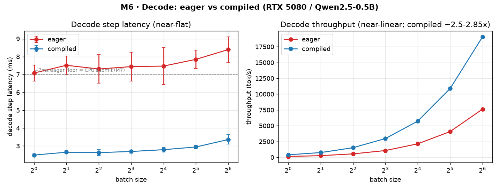
> decode 单步延迟近平、吞吐近线性；compiled（CUDA Graph FULL）比 eager 快 2.5–2.85×；eager ~7ms 地板由 M7 证实是 CPU 提交开销。

**M6 · Prefill：延迟 vs 输入长度**
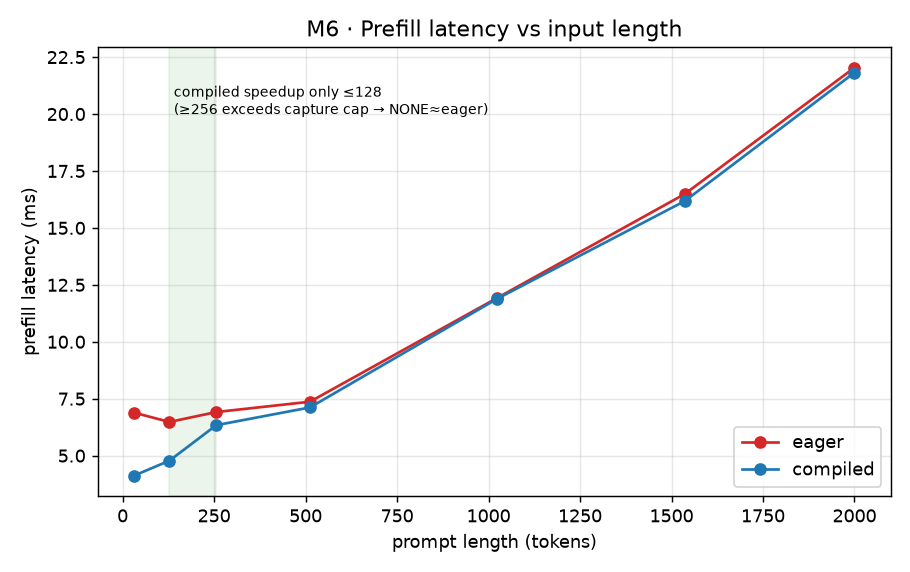
> compiled 仅在 ≤128 提速（PIECEWISE 图）；≥256 超本配置捕获上限 → 回退 NONE ≈ eager。

**M10 · 量化随负载而异（诚实反常）**
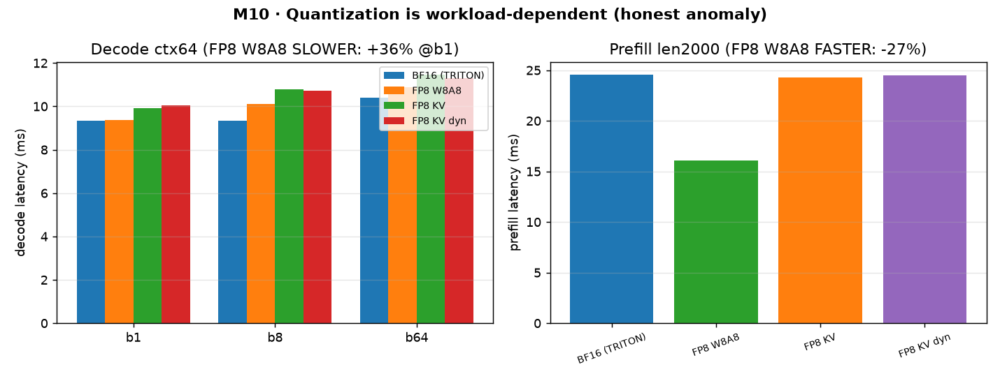
> FP8 W8A8 在**长 prefill 快 27%**（计算受限受益），却在**小 batch decode 慢 36%**（GEMV 访存受限 + 动态激活量化开销 + sm_120 未优化）。"量化提速"不是普适结论。

**M12 · 在线容量与 SLO 拐点**
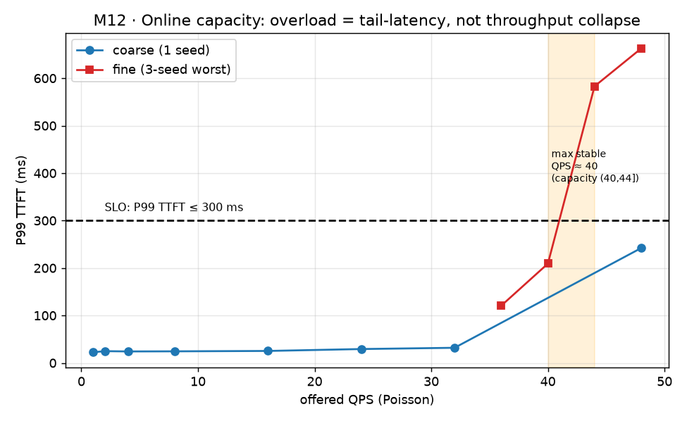
> QPS≤32 队列恒空、P99 TTFT 平稳 ~25–32ms；最大稳定 QPS≈40（3-seed worst 判 SLO）；44/48 时 P99 TTFT 破 300ms 线但吞吐仍跟随——**过载是尾延迟劣化，不是吞吐崩溃**。

**M17 · APC：收益必须长到穿透固定开销地板**
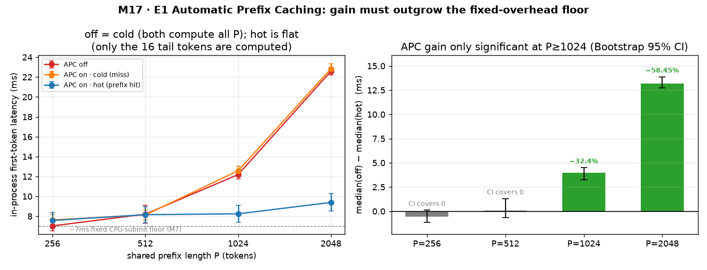
> 左：`off` 与 `cold`（APC 开但未命中）几乎重合——两者都要算完整 P；`hot` 几乎水平，因为命中后只算 16 个尾 token。右：median 差的 **Bootstrap 95% CI**——**P=256/512 的 CI 含 0**（收益无法与噪声区分），**P=1024/2048 才显著**（−32.4% / −58.5%）。误差棒=15 次 measure 的 stdev / CI，均排除 warmup 样本。

**M17 · Chunked prefill：只改尾部，不改中位**
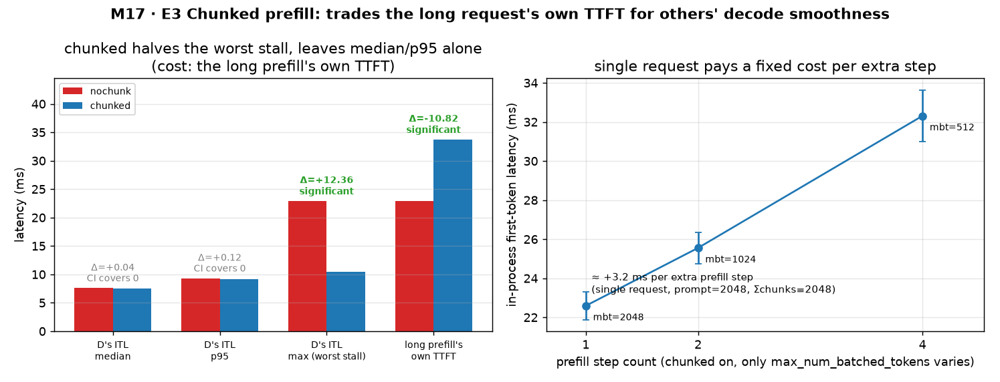
> 左（两侧 `max_num_batched_tokens=4096` 严格单变量，chunked 侧靠 `long_prefill_token_threshold=512` 强制分成 4×512）：并发 decode 请求 D 的**最坏 stall 22.87→10.51ms（−54%，CI 显著）**，而 **ITL median/p95 的 CI 都含 0**；代价是长 prefill **自身 TTFT +47%（显著）**。右：单请求下每多一个 prefill step ≈ **+3.2ms**，量级与 M7 所证的每-step 固定 CPU 提交开销一致。

**M19 · N-gram Spec Decode：额外并行 verification → 更少串行 execution rounds**
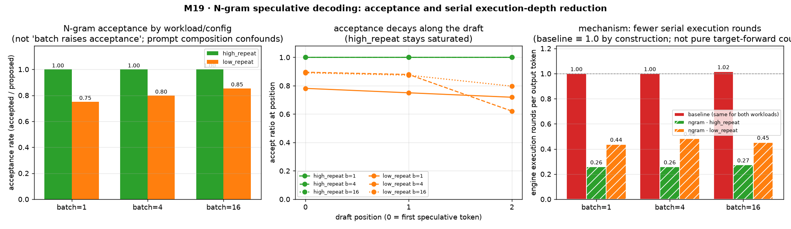
> 左：acceptance 随 workload/config 组合变化（高初始 prompt 重叠 **1.000**；低初始 prompt 重叠 0.75–0.85——后者**不是**真正低输出重复）。中：较远 draft position 更难命中（low b4 第 3 位 0.621；**未扫 k**）。右：每输出 token 的 **engine execution rounds**（强 proxy，非严格 target-forward 计数）从 baseline 1.0 降到 **0.26** / **0.44–0.48**。

**M19 · 延迟与吞吐：batch≤16 未见退化（未触及 knee）**
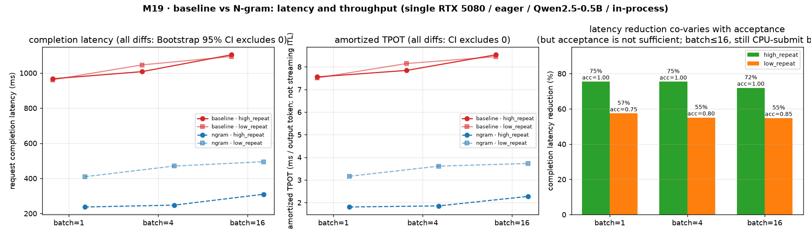
> 完成延迟与 **amortized TPOT**（≠ streaming ITL）的 **6+6 组 CI 全排除 0**。降幅与 acceptance 同向排序，但 Acceptance 非充分（high 恒 1.0 仍有 75.5%→72%）。batch=16 仍保持 72%/55%——本机 eager decode 仍 **CPU 提交受限**（M7），**未跑到「多算 verification 要付算力」的拐点**。≠「大 batch 也安全」。

**M22 · 4×H20 Tensor Parallel：decode 单步更慢 vs prefill 加速（口径必须拆开）**
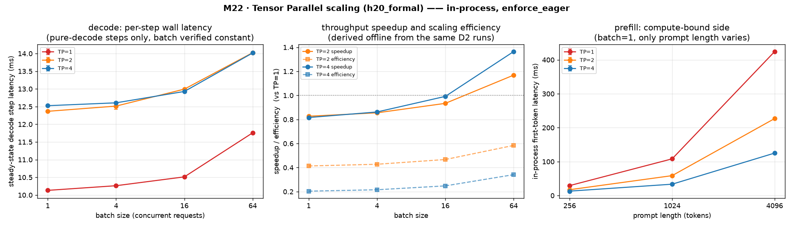
> 左：稳态 decode 单步 TP 全程更慢（~+19–24%，CI 排除 0）。中：吞吐 `speedup_vs_tp1` 在大 batch 可 >1——**主要来自并发 prefill**。右：长 prompt first-token 随 TP 加速（P=4096 TP4≈3.39×）。边界：H20 / 7B / eager / in-process；**PP/DP/EP 未做**。

**M24 · Decode Context Parallel：KV 容量翻倍，decode 单步更慢（不是 Ring Attention）**
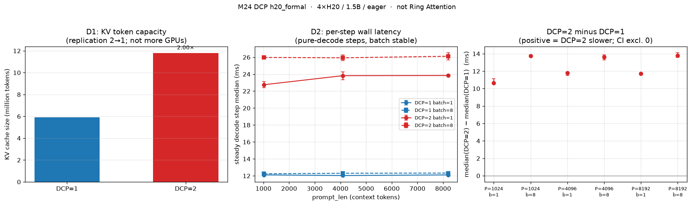
> 左：DCP=2 把 KV token 容量精确变成 2.0×（复制因子 2→1，GPU 数不变）。中：六档稳态 decode 单步 DCP=2 全程更慢。右：median difference 的 Bootstrap 95% CI 全部排除 0（+10.6～+13.8 ms）。边界：4×H20 / 1.5B / eager / in-process；**Ring Attention / P-D 未做**。

**M21 · 容量阶梯与瓶颈签名**
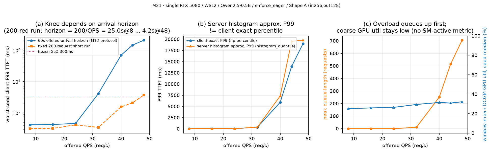
> 左：同一系统，5s 采样窗口判 QPS44「达标」，60s 窗口判 QPS32 已破线——**容量结论对采样窗口极敏感**。中：服务端 `histogram_quantile` 与客户端 `np.percentile` 不是同一个数。右：过载先堆队列（waiting 705），GPU 窗口均值仅 25→32%。

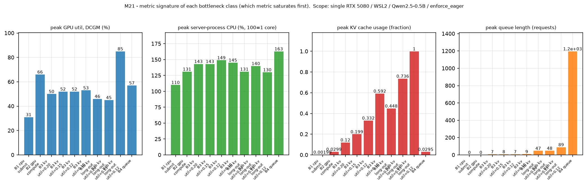
> 四类瓶颈「哪个指标先饱和」。注意 B3：只压 `--gpu-memory-utilization` 到 0.10 也造不出抢占，必须从需求侧（长输出，B3b）才把 KV 打满到 0.9997 并触发 290 次抢占。

**M20 · Same-runtime：vllm serve vs Triton+vLLM backend**
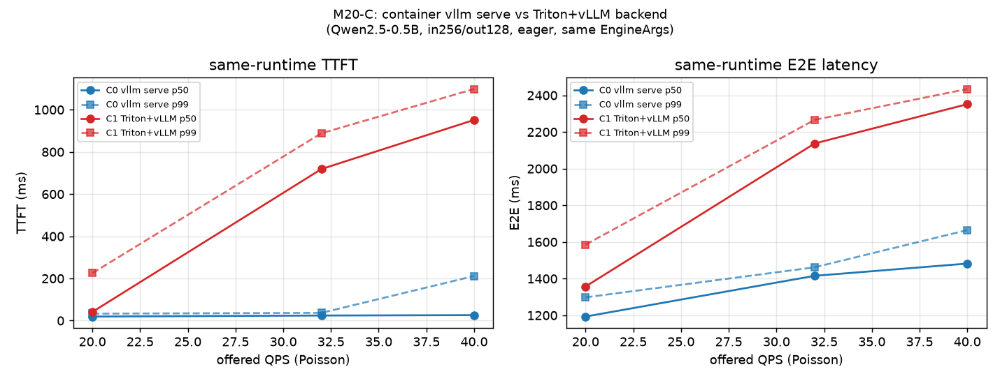
> 同镜像 / 同 EngineArgs / Poisson Shape A。高 QPS 下 Triton 侧 TTFT 显著变差（32: 24→719ms；40: 26→952ms），ITL 接近 → **入口排队税**，不是逐步解码变慢。

---

## 逐模块成果（M0–M13 + M17，不遗漏信息）

| 模块 | 一句话成果 | 关键数据 | 源码改动 | 证据 |
|---|---|---|---|---|
| **M0** 环境/基础设施 | 固定版本 + 统一 trace 工具 + 零副作用回归 | commit ee0da84 / Qwen2.5-0.5B / sm_120；trace-off 归一化逐行一致 | 只读钩子（默认关） | `logs/m1/{vllm_collect_env,nvidia_smi_*.txt}`、`patches/new_files/vllm/_lab_trace.py` |
| **M1** 主链路 Trace | 单请求从入口到输出的完整数据流 | backend=FLASH_ATTN；prefill/decode shape 对照 | 无 | `notes/m1/*` |
| **M2** Continuous Batching | 错峰混批、token 预算、chunked prefill | 同批 prefill+decode；max_num_seqs 排队；E5 预算共享/槽位争用 | 无 | `notes/m2/*` |
| **M3** KV / Block 管理 | 逻辑→物理块、prefix 命中、抢占重算 | hash/ref_cnt/共享/对齐；K5 尾部优先淘汰、前缀优先保留 | 无 | `notes/m3/*` |
| **M4** Attention Backend | **闭环**：SchedulerOutput→KV 写(slot_mapping)→读(block_table) | GQA 14/2/64；kv_cache shape (34801,2,16,2,64) | 2 只读钩子 | `notes/m4/*`、`outputs/m4/m4_closed_loop.jsonl` |
| **M5** 执行模式 | enforce_eager 实为一票否决；默认 O2 compiled 在 sm_120 未降级 | 捕获 51 PIECEWISE+35 FULL；compiled 与 eager 第 5 token 起分叉(数值差异非 bug) | 2 只读钩子 | `notes/m5/*`、`outputs/m5/*` |
| **M6** 引擎 Benchmark ★ | decode 近平/吞吐近线性、prefill 计算受限、KV 容量 | compiled 全 batch 快 2.5–2.85×；KV≈12KiB/token；最大并发 357× 是容量等价值(运行受 max_num_seqs=64 限) | 无 | `notes/m6/*`、`outputs/m6/baseline.csv` |
| **M7** Profiler ★ | decode 地板=CPU 提交；长 prefill=GPU 计算受限 | eager gpu_frac 0.23、257 提交→compiled 15、wall 7.44→2.50ms；prefill gpu_frac 0.88 | 无 | `notes/m7/*`、`outputs/m7/profile_*.json` |
| **M8** Triton Kernel ★ | 自写 slot_mapping 生成 kernel，三路交叉全绿 | **22/22**；microbench 自写≈vLLM 官方(28.4≈28.4us) | 无（官方作参照） | `notes/m8/*`、`outputs/m8/correctness.json` |
| **M9** profiler 驱动改动 ★ | 合并 decode H2D：机制成立但 E2E 无收益（诚实） | cudaMemcpyAsync/step 11→10；E2E 差异 ±0.01-0.02ms≪stdev；天花板 0.13% | 门控改动(默认关,可回退) | `notes/m9/*`、`outputs/m9/*` |
| **M10** 量化对比 ★ | FP8 显存收益明确、速度诚实含反常 | 权重 −36% / KV ~2×；PPL +0.51%~+2.17%；decode **+36% 变慢**、prefill −27% | 无 | `notes/m10/*`、`outputs/m10/*` |
| **M11** 双卡 TP | → 并入 **M22**（已在 4×H20 完成 TP E/H） | 见 M22 | — | `notes/m22/results.md` |
| **M12** 在线 Serving/SLO | 真实 serve + 开环 Poisson 的容量规划 | **最大稳定 QPS≈40**、饱和~46.6、过载=尾延迟劣化、容量随 shape 变 | 无 | `notes/m12/*`、`outputs/m12/*` |
| **M13** 首次上游 PR ★ | ✅ **PR [#51017](https://github.com/vllm-project/vllm/pull/51017) 已提交**（Ready for review，未合入） | **18 passed**、DCO pass、1 commit/1 file/+384、零产品改动；变异测试证明 oracle 独立性；避开 #39591 同名冲突 | 纯加测试 | `notes/m13/*`（研究/审查/验证/PR 草稿全留痕） |
| **M17** APC & Chunked Prefill ★ | 量化 APC 的生效边界与 chunked prefill 的真实权衡 | APC：P=2048 **−58.5%**、P=1024 −32.4%（CI 排除 0），P=256/512 **CI 含 0**；chunked：D 最坏 ITL **−54%**、median/p95 CI 含 0、长 prefill TTFT **+47%**；I1–I4 全过；**主线收口，2 项可选扩展已补齐（I5-b 相对降幅 61.2%→3.4%、no-chunk 正确性 9/9）** | 无 | `notes/m17/*`、`outputs/m17/*`、`logs/m17/*` |
| **M19** Spec Decoding（N-gram）★ | 额外并行 verification 换更少串行 execution rounds；Coverage+Acceptance+Round Cost | acceptance **1.000**(高初始重叠)/0.75–0.85(低初始重叠)；engine rounds **128→33 / 56–62**；完成延迟 −**72–75.5%** / −**54.8–57.4%**；amortized TPOT 7.6→**1.8ms**；吞吐 **+257–308%** / **+121–135%**；KV capacity **−1.9%**；111/126 exact match + batch-shape control；**T+E+O CLOSED**；Optional: draft/EAGLE/k sweep | 无（`stat_loggers=` 扩展点） | `notes/m19/*`、`outputs/m19/*`、`logs/m19/*` |
| **M23** 跨引擎 vLLM vs TRT-LLM ★ | 2×2 execution-mode 严格对照 | `T-E vs V-E` **+45.0%** / `T-O vs V-O` **+20.1%**（TRT 更慢，CI 排除 0）；冷启动 60.7s vs 15.6/26.6s；两侧 optimized 收益 2.85×/2.97×；**L1 COMPLETE** | 无 | `notes/m23/results.md`、`outputs/m23/*`、`figures/fig14_m23_cross_engine.png` |
| **M25** 压缩（蒸馏/剪枝/低秩） | 推理岗 T：三类方法改权重/结构，不必然加速 | 蒸馏不天然缩词表/context；非结构化零权重≠少 FLOPs；低秩是 launch/中间激活 trade-off（Graph ≠ fusion）；**T COMPLETE**，不做 E | 无 | `notes/m25/compression.md` |
| **M24** CP / Ring / P-D ★ | DCP：KV 容量 2.0×，decode step 更慢；不是 Ring Attention | 六档 DCP=2 更慢 +10.6～+13.8 ms（CI 全排除 0）；KV tokens 5.90M→11.80M；PCP=2 在 4 卡 `world_size=8` 被拒；**T+DCP E COMPLETE**；Ring / P-D ⬜ | 无 | `notes/m24/results.md`、`outputs/m24/*`、`figures/fig15_m24_dcp.png` |
| **M18** 量化 W4A16 ★ | AWQ/GPTQ vs BF16，受控到只差量化算法 | 权重 −53.6%/−62.8%（可量化部分 −74.0%）、KV 容量 +5.9%/+30.1%；**速度 28 点 0 个变快**（23 点 CI 显著变慢）；ΔPPL +1.4~+5.0%；**COMPLETE** | 无 | `notes/m18/results.md`、`outputs/m18/*`、`figures/fig13_m18_w4a16.png` |
| **M21** 监控与容量规划 ★ | Prom+Grafana+DCGM+自写 exporter，容量/瓶颈/故障演练 | 指标守恒 21/21；服务端直方图近似 P99 比客户端 exact percentile 中位 **+9.7%**；本次最后达标档 **24**、首个失败档 32（**C ∈ [24,32)**，跨会话 24–32，不复现 M12 的 40）；监控开销 **≲1%**；7 条告警全部真实触发；**SIGKILL 留下持显存的孤儿 EngineCore**；**COMPLETE** | 无 | `notes/m21/results.md`、`monitoring/*`、`outputs/m21/*`、`figures/fig1{1,2}_m21_*.png` |
| **M20** Triton + same-runtime ★ | 同镜像对照 `vllm serve` vs Triton+vLLM backend | QPS32 TTFT **24→719ms**、QPS40 **26→952ms**（CI 排除 0）；ITL 接近；success=1.0；**COMPLETE** | 无 | `notes/m20/results.md`、`outputs/m20/c_same_runtime_*`、`figures/fig10_m20_same_runtime.png` |
| **M22** Tensor Parallel ★ | 4×H20 上量化「小 batch TP 更慢」与 prefill 侧加速；拆吞吐口径 | D2 稳态 step TP 显著更慢（~+19–24%，CI 排除 0）；D3 P=4096 TP4≈**3.39×**；bs=64 吞吐升主要来自 **first_token** 804→230ms 而非 step；权重≈1/TP；P1 见 custom AR/NCCL；**PP/DP/EP 未做** | 无 | `notes/m22/{results,tensor_parallel}.md`、`outputs/m22/h20_formal_*`、`figures/fig9_m22_tp_scaling_h20_formal.png` |
★ = 第一阶段核心验收项（M17/M19/M22 属第二阶段）。**第一阶段核心验收线 9/9**（原 M11 双卡 TP 已由 M22 在 4×H20 闭合）。

---

## 亮点洞察（面试可讲的"非显然"结论）

1. **decode 慢不是 GPU 慢，是 CPU 喂不饱 GPU**：eager 下 GPU 仅忙 23%，每步 257 次 kernel 提交；CUDA Graph 把提交降到 15、wall 砍掉 2/3。这是 continuous batching/CUDA Graph 存在的根本原因。
2. **"量化一定提速"是错的**：同一 FP8 权重量化，长 prefill 快 27%、小 batch decode 反而慢 36%——收益取决于计算受限还是访存受限。
3. **过载 ≠ 吞吐崩溃**：开环 Poisson 下，超过 SLO 容量后吞吐仍跟随 offered QPS，先崩的是 **P99 尾延迟**；所以"最大稳定 QPS(40)" < "饱和吞吐(46)"。
4. **省计算 ≠ 省延迟，但"长到一定程度"就等号了**：prefix cache 命中省掉 94% prefill 计算 token，短 prompt 下首 token 延迟改善却落在噪声内（M6）；M17 把前缀加长后发现这是**地板效应**——P=256/512 的 CI 仍含 0，而 P=1024/2048 省出 **32.4% / 58.5%**（CI 排除 0）。**同一份"省计算"，穿透那条 ~7ms 固定开销地板才变成"省延迟"。**
5. **chunked prefill 改的是尾部，不是平均**：它把并发 decode 的最坏 stall 砍半（22.87→10.51ms），但 ITL 的 median/p95 几乎不动（CI 含 0），且长 prefill 自己的 TTFT 变慢 47%——**这是一次公平交换，不是免费加速**。另外机制不是"长 prefill 把 decode 挤出去"：原始逐 step 记录显示 decode **仍被同批调度**（`d=1, p=2048`），只是它的 token 要等一个 2049-token 的长 step 才返回。
6. **不是所有 profiler 热点都值得改**：M9 的 H2D 合并机制成立、正确，但该路径已被上游高度优化（pinned+non_blocking+overlap），isolated microbench 提前算出天花板仅 0.13%——**能证明"为什么没收益"也是能力**。
7. **投机解码优化的是串行 execution depth，不是保证少算**：M19 直接计数 engine execution rounds（强 proxy，非严格纯 Decode Target Forward），高初始 prompt 重叠 workload 从 128→33。Acceptance 重要但非充分；还需 Proposal Coverage 与 Round Cost。教科书「batch 增大收益消失」在本机 batch≤16 **未触及**——仍是 M7 的 CPU 提交受限区，**不等于规律不成立**。
8. **"输出不一致"不等于"实现有 bug"**：M19 有 15/126 请求 baseline↔ngram 不完全一致。batch-shape control 证明 **baseline 自己**换 batch 组成也可在相近位置分歧——现有证据与有限精度 batch-shape sensitivity **一致**，**未发现明确 Spec Decode correctness bug**，但也不是严格逐例排除。**先找对照组，再定证据强度。**
9. **TP 的「吞吐加速」≠「decode 单步变快」**：M22 在 4×H20 / 7B 上，稳态 decode 单步 TP 全程显著更慢（~+19–24%，CI 排除 0）；bs=64 时 `speedup_vs_tp1>1` 主要来自并发 prefill 的 first-token（804→230ms）。**口径拆不开就会把通信税说成加速。**
10. **Triton overhead 主要在 TTFT 排队，不在逐步 ITL**：M20 same-runtime 下 QPS 32/40 时 Triton+backend 相对同镜像 `vllm serve`，TTFT median 从 ~24ms 涨到 ~0.7–1.0s（CI 排除 0），而 ITL 仍 ~11ms 量级。
11. **"面板好看"和"数字是真的"是两件事**：M21 先用守恒律验证服务端指标（21 个窗口 counter 增量与客户端 bench 逐条精确相等），才发现服务端 `histogram_quantile` 的**近似** P99 比客户端 **exact percentile** 系统性偏高（中位 +9.7%，最大 +68%）。差异同时来自统计表示（histogram 只存 bucket 计数）、观测边界（server vs client 计时起止点）与窗口聚合，**本实验无法归因到单一项**——能下的结论是**两者不可互换**：面板 P99 适合趋势和告警，SLO 验收用客户端 exact percentile。同理，DCGM 与 NVML 两条独立采集路径的交叉校验，抓出了 `dcgm-exporter` 默认 30s 采集间隔导致的过期读数（DCGM 报 2% 而 NVML 同期 33%）。
12. **`up==0` 不代表资源已释放**：M21 实测 `SIGKILL` vLLM API server **不会**杀死持有显存的 `EngineCore` 子进程——告警 4s 内响，但显存 90 秒不回收，下一次拉起直接撞 `No available memory for the cache blocks`；清掉子进程后 5s 回收、28s 恢复。判断服务是否干净退出必须同时看 `DCGM_FI_DEV_FB_USED` 是否回到基线。
13. **容量数字有保质期**：M21 用与 M12 完全相同的配置与 bench 参数，测出最大稳定 QPS 24（M12 是 40）。单变量 A/B 排除了监控开销（≲1%），NVML 排除了降频，单流 ITL 说明机器没整体变慢——差异出在高并发下 TPOT +30%，按 Little's law 把所需并发从 48 推到 62、顶上 `max_num_seqs=64` 的硬闸形成正反馈。**根因未定**（M12 当年没留环境指纹），故如实标注「容量跨会话不稳定 24–32」，既不宣称复现 40，也不宣称 40 是错的。
14. **开 DCP ≠ Ring Attention，也不等于 decode 变快**：M24 在 4×H20 / 1.5B 上只改 `decode_context_parallel_size`，KV 可服务 token **恰好 2.0×**，但六档稳态 decode 单步全部显著更慢（CI 排除 0）。chrome trace 里的 `AllGather_RING_LL` 是 NCCL 算法名。长上下文在本网格也没有翻盘——**容量口径和 step 延迟口径必须拆开**。

> 完整证据链见 [`notes/evidence_index.md`](notes/evidence_index.md)；每个结论都可回溯到 trace/log/jsonl/csv。

---

## 复现

```bash
cd /home/ciaran/projects/vllm-inference-lab
source .venv/bin/activate

# 环境自检（不加载模型）
python scripts/smoke_import.py
# 确认实际加载的是 vllm-src（editable）
python -c "import os, vllm; print(os.path.realpath(vllm.__file__))"

# 各模块实验（示例；运行需本机 GPU，注意 GPU 占用）
VLLM_USE_FLASHINFER_SAMPLER=0 python scripts/m6_run_all.py      # 引擎 benchmark
VLLM_USE_FLASHINFER_SAMPLER=0 python scripts/m7_run_all.py      # profiler
python scripts/m8_test.py                                       # Triton kernel 三路交叉
VLLM_USE_FLASHINFER_SAMPLER=0 python scripts/m10_run_all.py     # 量化对比
python scripts/m12_run_sweep.py                                 # 在线开环 serving + SLO 扫

# M17：一个进程只建一个引擎（同进程内多引擎无法归还 KV 显存），故必须分片跑
python scripts/m17_prefix_cache.py --shard e1-on
python scripts/m17_prefix_cache.py --shard e1-off
python scripts/m17_prefix_cache.py --shard e3 --e3-chunked on --e3-mbt 512   # 另跑 1024/2048/4096
python scripts/m17_prefix_cache.py --shard e3-conc --conc-mode chunked       # 另跑 nochunk
python scripts/m17_prefix_cache.py --shard summarize            # 汇总，不建引擎、不需 GPU

# M19：Baseline vs N-gram 投机解码（同样一个进程一个引擎）
python scripts/m19_spec_decode.py --shard smoke --mode ngram   # 先自检：ngram 是否真生效
python scripts/m19_spec_decode.py --shard baseline
python scripts/m19_spec_decode.py --shard ngram
python scripts/m19_spec_decode.py --shard summarize            # 汇总，不建引擎、不需 GPU
python scripts/m19_spec_decode.py --shard equiv --mode baseline   # 输出一致性 probe
python scripts/m19_spec_decode.py --shard equiv --mode ngram
python scripts/m19_spec_decode.py --shard summarize-equiv

# 统一复现入口 + 正式不变量（均不需 GPU）
python scripts/reproduce.py --list
python scripts/reproduce.py --module m19 --dry-run
python scripts/reproduce.py --module m19 --verify-only
python scripts/check_invariants.py                             # M0 / M17 / M19 / … / m24

# 核心图（无需 GPU，仅由已落盘数据生成）
python scripts/m16_figures.py    # -> figures/fig1..4
python scripts/m17_figures.py    # -> figures/fig5..6
python scripts/m19_figures.py    # -> figures/fig7..8
python scripts/m22_figures.py --tag h20_formal  # -> figures/fig9_m22_tp_scaling_h20_formal.png
python scripts/m20_figures.py                    # -> figures/fig10_m20_same_runtime.png
python scripts/m18_figures.py                    # -> figures/fig13_m18_w4a16.png
python scripts/m23_figures.py                    # -> figures/fig14_m23_cross_engine.png
python scripts/m24_figures.py --tag h20_formal   # -> figures/fig15_m24_dcp.png
python scripts/m21_figures.py                    # -> figures/fig11_m21_capacity.png, fig12_m21_bottleneck_signature.png
```

关键运行约定（本机 WSL2/sm_120）：`VLLM_USE_FLASHINFER_SAMPLER=0`（无 nvcc，FlashInfer sampler JIT 会失败）、`VLLM_ENABLE_V1_MULTIPROCESSING=0`、`seed=0`、`temperature=0`。

---

## 工作区结构与约束

```text
/home/ciaran/projects/
├── vllm-src/           # vLLM 源码（学习用真源）。ee0da84=v0.24.0，含中文学习注释
├── vllm-m13-upstream/  # M13 上游 PR 专用：干净 clone + 独立 .venv，跟最新 main（无学习注释）
├── vllm_playground/    # 干净基线 venv（只读，不得修改）
└── vllm-inference-lab/ # 本工作区
    ├── scripts/        # 各模块实验脚本 + 离线出图 + reproduce.py / check_invariants.py
    ├── config/         # repro_manifest.yaml（模块→命令/产物/日志/环境/不变量 的统一登记）
    ├── notes/          # 逐模块源码学习笔记（含 evidence_index / m16 面试表达）
    ├── outputs/        # 实验输出（csv/json/jsonl；大件 raw/traces 走 gitignore、可复现）
    ├── figures/        # 核心图（由 CSV 离线生成）
    ├── logs/           # 实验日志、git 状态快照
    ├── ROADMAP.md      # 两阶段里程碑（M0–M26）
    ├── AGENTS.md / HANDOFF.md
```

- **源码修改只发生在 `../vllm-src`**；本目录 `.venv` 以 editable 安装 vllm-src，Python 改动重启进程即生效；`csrc`/CUDA kernel 用 `VLLM_USE_PRECOMPILED=1` 复用预编译，源码级改动不自动生效。
- **上游贡献与学习树严格隔离**：`vllm-src` 为便于学习加了中文注释、且 pin 在 v0.24.0（脏树、shallow），**不可用于提 PR**；M13 因此另建 `vllm-m13-upstream`（干净 clone + `uv` 独立 venv + 跟最新 main），保证提交的 diff 只含目标文件。
- 不修改 `../vllm_playground/.venv`（只读基线）；不对 `../vllm-src` 执行破坏性 git 操作；环境记录不写任何密钥/Token。
- 本目录**是 git 仓库**，已推送至 `github.com/CiaranCw/vLLM-Inference-Lab`（提交者仅 CiaranCw）。

---

## §7 M13 首次上游 PR —— 已提交

> **[vllm-project/vllm#51017](https://github.com/vllm-project/vllm/pull/51017)** · `[Core] Add unit tests for BlockTable slot mapping` · **Ready for review**（2026-08-04 提交）
> 目标是**完整经历一次上游贡献流程**，非必须合入——截至本文更新时**尚未合入**，等待 maintainer 审查。

**贡献内容**：为 vLLM `vllm/v1/worker/block_table.py` 的 `BlockTable.compute_slot_mapping`（含其 Triton kernel）补**单元测试**——该路径此前在 `tests/` 中**零直接覆盖**，而它把逻辑 token 位置映射到物理 KV slot，错一位会**静默写坏 KV cache**（不报错），且含 hybrid 块 / DCP interleave / CUDA-graph padding / `SlotMappingMode.NONE` 等易错分支。

| 项 | 事实 |
|---|---|
| PR | [#51017](https://github.com/vllm-project/vllm/pull/51017)，base `24c939c`，head `4dd4fa7` |
| 规模 | **1 commit / 1 file / +384 / −0**，**零产品代码改动**（test-only） |
| 落点 | `tests/v1/worker/test_block_table_slot_mapping.py` |
| 测试 | **18 passed**（3 类手算 golden + 边界/ragged/prefix + 跨 1024 Triton tile padding + DCP 全 rank + hybrid 32/16 & 64/16 + `SlotMappingMode.NONE`） |
| CI | **DCO pass** ✅、mergify Summary pass、Meta Internal-Only pass；`pre-commit` job 在上游 runner 队列中（本地同 hook 集 13 Passed / 0 Failed） |
| 合规 | `git commit -s`（`Signed-off-by: CiaranCw`）+ `Assisted-by: Claude Code`（AGENTS.md 要求披露 AI 辅助）；提交前人工逐行审查、手算复核 golden、本人复跑测试 |

**工程判断（这次贡献里最有价值的部分）**：
1. **不盲信旧笔记**：候选研究基于 v0.24.0，动手前对**最新 main** 重新核实，发现 3 处语义已漂移——slot mapping **已改为只按 DCP 分片**（PCP 不再参与）、新增 **hybrid 块三分语义**（`kv_cache_block_size`/`kernel_block_size`/`blocks_per_kv_block`）、新增 **`SlotMappingMode`**。按旧假设写的测试根本跑不起来。
2. **Oracle 必须独立**：初版参照实现复用了产品的 `map_to_kernel_blocks`——用**变异测试**证明了风险真实：给该 helper 注入 `+1` 后，复用版本的 hybrid 用例**仍然通过**（漏检）；改为测试内自建展开后，3 个 hybrid 用例**全部失败**（正确捕获）。
3. **三方独立锚定**：手算 golden 与 numpy oracle 相互独立地钉住 kernel 输出，避免「参照实现与被测代码同错」。
4. **主动规避冲突**：发现 open PR #39591 会创建同名文件（但它测 row-tail 清零、完全不碰 slot mapping），故改用 `test_block_table_slot_mapping.py` 并在 PR 里说明、表示愿合并。
5. **前车教训**：stale PR #30683 曾提出同方向测试，**死于 pre-commit 未过后无人跟进**（非评审否决）——所以本次把 pre-commit 全绿当作硬门槛。

**完整过程留痕**：`notes/m13/`（[STATUS.md](notes/m13/STATUS.md) 断点快照 · [pr_slot_mapping_test.md](notes/m13/pr_slot_mapping_test.md) 研究与语义漂移 · `review/` 逐行审查+手算 golden+清单 · `validation/` 测试/pre-commit/变异回归日志 · `pr_draft/` 最终测试与 PR 正文）。
**待回填**：`[ ]` maintainer review 往返与迭代　`[ ]` 是否最终合入。

---

## §8 M17 APC & Chunked Prefill

> 第二阶段阶段 E 的首个模块。**T + O + E 已完成**（`notes/m17/`）。

**方法**：用 `LLMEngine` + `ScheduleSpy` 包裹 `scheduler.schedule` 抓 `SchedulerOutput`，逐 step 读**每请求**的 `num_scheduled_tokens`（只读 `total_` 无法分离 prefill 与 decode）。每配置 **5 warmup + 15 measure**，汇总只用 measure；统计口径为 median difference 的 **Bootstrap 95% CI**（10000 次，固定 seed=0，仅 stdlib）。

| 实验 | 构造 | 主结论 |
|---|---|---|
| **E1** APC | 共享前缀 P∈{256,512,1024,2048} + 独立 16-token 后缀；`off` / `cold`(未命中) / `hot`(命中) 三侧 | **P=1024/2048 收益显著**（−32.4% / −58.5%，CI 排除 0）；**P=256/512 的 CI 含 0** |
| **E3-single** 分块成本 | prompt=2048、只变 `max_num_batched_tokens` | Σchunks **恒 2048**、步数恰为 `ceil(2048/预算)`；单请求每多一步 ≈ **+3.0–3.2ms** |
| **E3-conc** ITL 抖动 ⭐ | decode 请求 D 稳定后插入 2048 长 prefill；**两侧 mbt=4096 严格单变量** | D 最坏 stall **−54%**、**median/p95 的 CI 含 0**、长 prefill 自身 TTFT **+47%** |

**两个值得单独说明的实验设计点**：
- **单变量对照不能靠"关开关"**：`enable_chunked_prefill=False` 时上游强制要求 `max_num_batched_tokens >= max_model_len`（`vllm/config/scheduler.py:268-279`），所以「off + 小预算」这个对照**无法构造**。改为两侧都 `mbt=4096`，chunked 侧单靠 `long_prefill_token_threshold=512` 强制分块（实测 4×512），两侧 D 的 ITL 样本数均为 92 → 可比。
- **一个进程只建一个引擎**：vLLM 引擎的 KV 显存 `del` + `empty_cache()` 也归还不掉（M6 已证），故脚本按 `--shard` 分片，每配置独立进程。

**机制（以原始逐 step 记录为准）**：nochunk 时长 prefill 那一步是 `d=1, p=2048, total=2049`——**D 仍被同批调度了 1 个 decode token**，只是该 token 的返回被这个长联合 step 整体推迟；chunked 侧每步 `d=1, p=512, total=513`，D 同样每步产出但等待更短。→ chunked prefill 改善的是「要等多长的一个 step」，不是「是否被调度」。

**可选扩展已于 2026-08-13 补齐**：`[x]` **I5-b** 输出长度定量实验（180 measure）——固定 2048 前缀扫 `max_tokens ∈ {1,8,32,128}`，相对降幅 **61.2% → 22.9% → 9.3% → 3.4%** 单调下降，**定量支持「APC 只省 prefill」**；`max_tokens=128` 档完成延迟 CI 含 0。**口径按实测修正**：恒定的是**首 token** 绝对收益（14.6–15.2ms，四档 CI 全排除 0），完成延迟的绝对差反而随输出变长增大（14.6→35.7ms，来自约 2% TPOT 差累积，**不声称机制**）。`[x]` **E3 no-chunk 生成正确性**——**9/9 case 输出 token 逐一相同**，故保留性能结论并注明「有限 case 验证」，**不外推**为「关闭 chunked prefill 普遍安全」。**仍未做**：`[ ]` **E2** block 生命周期 `ref_cnt`/驱逐内省（脚本未实现）。
**适用边界**：单卡 / eager / 0.5B / WSL2 / in-process，绝对值限本配置；**跑间有 1–3ms 漂移**，故只对「显著/不显著与量级」下结论。**首版（2026-08-04）结论因单样本且被首次 Triton JIT 编译污染已整体撤回并重跑**，撤回明细见 [`notes/m17/results.md`](notes/m17/results.md) §6。

**留痕与数据**：[`results.md`](notes/m17/results.md)（结果 + 撤回表）· [`prefix_cache_and_chunked_prefill.md`](notes/m17/prefix_cache_and_chunked_prefill.md)（T/O 源码定位 + 冻结设计 + 不变量 I1–I5）· `outputs/m17/*.csv` + `outputs/m17/raw/*.jsonl`（含 `phase`/`success`/`metric_scope`）· `logs/m17/*`。旧数据保留未删（`raw_old_20260805/`、`raw_pre_field_fix/`）。**零 vLLM 产品源码改动。**

**主线收口口径（2026-08-06；可选扩展 2026-08-13 补齐）**：核心实验完成并核验；**P0 no-chunk correctness 与 I5-b 已执行完毕，仅 E2 block 生命周期内省未做**。⚠ **必须随结论一起呈现的限制**：当前模型**不正式支持关闭 chunked prefill**（`vllm/engine/arg_utils.py:2476-2480` 明确告警），因此现有结果**主要支持调度形态与延迟观察，不外推为普适的生成正确性保证**。

---

## §9 M19 Speculative Decoding（N-gram 主线 · T+E+O CLOSED）

> **T + E + O 已完成并语义收口**（`notes/m19/`）。draft model / EAGLE / MTP / Medusa / `k` sweep 等为 **Optional / Future**，不阻塞主线。

用真实 vLLM N-gram Spec Decode 验证：**额外并行 verification 换取更少串行 execution rounds**；
高初始 prompt 重叠 workload 延迟约 −72–75%，低初始 prompt 重叠（非真正低输出重复）约 −55–57%；
建立 Proposal Coverage + Conditional Acceptance + Round Cost 性能模型；记录 KV capacity 约 −1.9%
与有限精度 output divergence 边界。

**方法**：`LLMEngine` + 自定义 `StatLoggerBase` 逐 step 收 `SpecDecodingStats`。网格：2×2×3，
每组 **5 warmup + 15 measure**。统计：median difference 的 **Bootstrap 95% CI**（seed=0）。

| 维度 | high_repeat（高初始 prompt 重叠） | low_repeat（低初始 prompt 重叠） |
|---|---|---|
| **acceptance rate** | **1.000**（draft-bearing length 4.000） | 0.750 / 0.798 / 0.854（batch 1/4/16；含 prompt-composition confounding） |
| **正交第二证据**（输出 4-gram∈prompt，离线） | **1.00** | **0.00**（但输出自身 4-gram 重复 ≈0.82–0.84） |
| **engine execution rounds**（强 proxy） | 128 → **33**（−74%） | 128 → **56–62**（−52~−56%） |
| **完成延迟** | −**72.0~75.5%** | −**54.8~57.4%** |
| **amortized TPOT**（≠ streaming ITL） | 7.6–8.5ms → **1.8–2.3ms** | 7.5–8.5ms → **3.2–3.7ms** |
| **in-process 输出吞吐** | **+257~308%** | **+121~135%** |

**隐藏变量已写死**：两侧 `async_scheduling=False`、`disable_log_stats=False`；`effective_cfg` 从引擎读回核对。

**代价与边界**：KV capacity **−1.9%**；batch≤16 **未触及 knee**；**未扫 k**；未做 profiler breakdown / compile / draft-model family；
batch↔prompt confounding。正确性：111/126 exact match；batch-shape control 支持 numerical sensitivity 解释，
**非严格「与 Spec Decode 无关」证明**。

**留痕**：[`results.md`](notes/m19/results.md) · [`speculative_decoding.md`](notes/m19/speculative_decoding.md) ·
`outputs/m19/*.csv` + `raw/*.jsonl` · `logs/m19/*`。`check_invariants.py --module m19`。**零产品源码改动。**

---

## §10 M21 监控与容量规划（T+E+O COMPLETE）

**栈**：`vllm serve`(8014) + `dcgm-exporter`(9400) + 自写 `m21_host_exporter`(9836) → Prometheus(**1s 抓取** + 7 条告警) → Grafana（面板由 provisioning 从文件加载，不靠 UI 手点）。全部配置在 [`monitoring/`](monitoring/)。

**先证明指标可信，再谈结论**（这是本模块的顺序）：

| 层次 | 做法 | 结果 |
|---|---|---|
| 守恒律 | 21 个压测窗口，服务端 counter 增量 vs 客户端 bench 汇总 | 完成数 / prompt tokens / generation tokens **逐条精确相等** |
| 口径差 | 服务端 `histogram_quantile`（近似） vs 客户端 `np.percentile`（exact） | 服务端 P99 系统性偏高：TTFT 中位 **+9.7%**（范围 −10.4%~**+68.2%**）。差异来自统计表示 + 观测边界 + 窗口聚合三者，**不可归因到单一项**；结论是两者**不可互换** |
| 交叉校验 | DCGM vs NVML 两条独立采集路径 | 抓出 `dcgm-exporter` 默认 **30s** 采集间隔导致的过期读数（DCGM 2% vs NVML 33%），改 `-c 1000` 后收敛 |

**五个工程问题的答案**（边界：单卡 RTX 5080 / WSL2 / Qwen2.5-0.5B / `enforce_eager` / 单副本）：

1. **最大稳定 QPS**：本次会话最后一个达标档 **24**、第一个不达标档 **32**（3 seed worst-case 判 P99 TTFT ≤300ms）。两种记号要分清：**拐点定位到 (24, 32]**，而**未知的真实容量 C ∈ [24, 32)**。**跨会话不稳定 24–32**，见下。
2. **P99 何时失控**：QPS 32 起 waiting 开始堆积、worst-seed P99 TTFT 从 46ms 跳到 415ms；48 时 waiting 峰值 705、P99 21 秒。
3. **瓶颈是谁**：过载时**粗粒度 GPU util 窗口均值仅 25→32%**，与「算力饱和」不符，压力在队列/准入。四类压力源的签名见 `fig12`（本环境无 `DCGM_FI_PROF_*` SM-active 指标，故只能说 GPU compute pressure 强弱，不能断言饱和）。**负结果**：只压 `--gpu-memory-utilization` 到 0.10 也造不出 KV 抢占（需求侧被 `max_num_seqs×384 tokens` 封顶），必须用长输出从需求侧构造，才把 KV 打满 0.9997、触发 290 次抢占。
4. **一张卡多少用户**：Interactive Response Time Law。X=24 时平均**在系统内的请求数** L = X·R ≈ **41.4**；按思考时间 5/15/30s 折算的**闭环用户总数** N = X·(R+Z) ≈ **161/401/761** 人（含正在思考、不在系统内的用户，**不是**并发请求数）；仅数量级，假设见 `results.md §6`。
5. **故障怎么定位**：4 个演练全 PASS，7 条告警规则**全部真实 firing 过**（其中 "OOM" 实为**启动期显存预算拒绝**，**未注入** runtime CUDA allocator OOM）。最有价值的一条：**`SIGKILL` API server 不会杀死持有显存的 `EngineCore` 子进程** —— `up{job="vllm"}` 4s 内归零，但显存 **90s 不回收**，下一次拉起直接撞 `ValueError: No available memory for the cache blocks`；清掉已记录的子进程 PID 后 **5s** 回收、**28s** 恢复。**`up==0` ≠ 资源已释放。**

**与 M12(≈40 req/s) 的差异——逐条排查后如实保留分歧**：
监控栈开销经单变量 A/B 证明 **≲1%**（非原因）；NVML 时钟/温度排除降频；单流 ITL 9.40ms 说明机器未整体变慢。
差异出在**高并发 TPOT 9.3→12.1ms(+30%)**：按 Little's law 所需并发从 48 推到 62，顶上 `max_num_seqs=64` 的硬闸 → 排队 → 再拉长 ITL 的正反馈。
**根因未定**（M12 当年没落环境指纹），因此**既不宣称复现 40，也不宣称 40 是错的**，只给区间与机制。本模块补了 `scripts/m21_env_fingerprint.py` 给后续模块留基线。

**留痕**：[`results.md`](notes/m21/results.md) · [`monitoring_and_capacity.md`](notes/m21/monitoring_and_capacity.md) · [`monitoring/README.md`](monitoring/README.md) ·
`outputs/m21/*.json` + `e3_shapeA_60s.csv` + `raw/*.jsonl` · `logs/m21/*` · `figures/fig1{1,2}_m21_*.png`。
`check_invariants.py --module m21`（**14 PASS / 0 FAIL**）。**零产品源码改动。**

> **2026-08-12 evidence audit**：修正了 E5 闭环 population 语义、E6 timeout 的秒/毫秒单位（19.57ms → **19568ms**）、
> E2 因果归因过强、「5s 窗口」表述、OOM 与 GPU-compute 术语、容量记号共 8 项口径问题。
> **未修改任何原始实验数据，未重跑 E3/E4/E7**；derived artifact 由已落盘 raw 离线重算。逐条见 [`results.md §10`](notes/m21/results.md)。

---

## §11 M18 W4A16 量化：AWQ / GPTQ vs BF16（T+E+O COMPLETE）

**先探后下**：本模块没有「先下载几 GB 再碰运气」。因为 `VLLM_USE_PRECOMPILED=1` 不自编译 CUDA，
「源码支持」不等于「wheel 里有 sm_120 cubin」，所以先做零成本探针——读准入门槛、让 vLLM 自己选 kernel
（三种 W4A16 配置全部选中 `MarlinLinearKernel`），再用**极小张量真 launch** 一次 `marlin_gemm`。
通过后才申请下载。这个顺序来自 M10 的教训（FP8 KV 纸面支持、实测必须换 `TRITON_ATTN` 后端）。

**受控到只剩一个变量**：AWQ 与 GPTQ 的 `bits=4` / `group_size=128` 完全相同，只差算法与 zero-point。
并且**显式冻结激活 dtype 为 bfloat16**——量化 checkpoint 的 config 声明 `float16`、BF16 基线声明 `bfloat16`，
用 `dtype="auto"` 就会把「4bit 量化」和「fp16 vs bf16 激活」混成一个数。

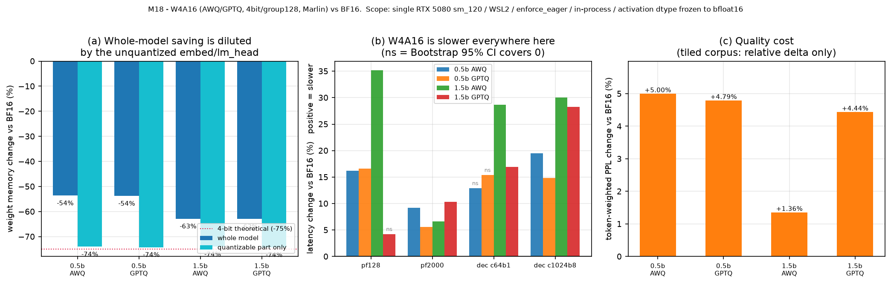

| 轴 | 结果 |
|---|---|
| **显存** | 整体权重 0.5B **−53.6%** / 1.5B **−62.8%**；但 `embed`/`lm_head` **完全未被量化**（不变量核对：三配置字节数一模一样），剔除后**可量化部分 −74.0%**，几乎就是 4bit 理论值 |
| **稀释规律** | embed 占基线权重 0.5B **27.6%** / 1.5B **15.1%** → **模型越小，量化的整体收益被摊薄得越厉害**。报「省了多少显存」必须说清分母 |
| **KV 容量** | +5.9%（0.5B）/ **+30.1%**（1.5B） |
| **速度** | **28 个对照点，0 个变快**；23 个 Bootstrap 95% CI 排除 0 的显著变慢 |
| **质量** | ΔPPL 0.5B +5.0%(AWQ)/+4.8%(GPTQ)；1.5B **+1.4%(AWQ)**/+4.4%(GPTQ) |

**一个不能推给「地板效应」的观察**：M7 已证本机 eager decode 是 CPU 提交受限，那 decode 不受益还说得通；
但 M7 同时证了**长 prefill(n=2000) 是 GPU 计算受限**（gpu_frac 0.88），而 W4A16 在这一段**仍然更慢**
（+9.2% / +6.6%，CI 均排除 0）→ 慢的来源包含 **Marlin W4A16 GEMM 本身**。
更细的机制（dequant 开销 vs sm_120 未优化）**没做 kernel profiling，因此不下判断**。

**执行前假设被推翻并如实记录**：设计冻结里我写的 H5 是「1.5B 比 0.5B 更容易显现收益」，
实测**相反**（1.5B decode 惩罚 +28.6% > 0.5B +12.9%）。加 1.5B 本是为控住 M7 地板效应这个混淆，
结果它反而证明了：在这两个规模上，W4A16 的速度劣势都不是地板效应造成的。

**留痕**：[`results.md`](notes/m18/results.md) · [`quantization_w4a16.md`](notes/m18/quantization_w4a16.md) ·
`outputs/m18/{memory,perf,quality}.csv` + `raw/*.jsonl` · `logs/m18/*`。
`check_invariants.py --module m18`（**11 PASS / 0 FAIL**）。**零产品源码改动。**

---

## §12 M23 跨引擎对照：vLLM vs TensorRT-LLM（L1 COMPLETE）

**先纠正一个已经过时的前提**：上游**已移除 TensorRT engine backend**，PyTorch 成为唯一执行后端
（`v1.3.0rc20` 是最后一个支持它的版本，`trtllm-build` / checkpoint 转换一并消失）。
所以「**vLLM = 动态 PyTorch** vs **TRT-LLM = 预编译 engine**」这个流行对立面**不再成立**。
真正的问题变成：**同为 PyTorch runtime，它们为什么仍是两套不同的推理引擎？**
（时间线与迁移影响见 [`backend_migration.md`](notes/m23/backend_migration.md)。）

**先探后投**：拉镜像前先做零成本 Gate 设计，且把红线写死——
`import 成功 ≠ PASS`、`load 成功 ≠ PASS`、`GPU 可见 ≠ PASS`，**必须真实 generate 出文本才算通过**
（sm_120 的 kernel 问题往往只在真正执行 forward/attention/decode 时才暴露）。结果三个 Gate 全过。

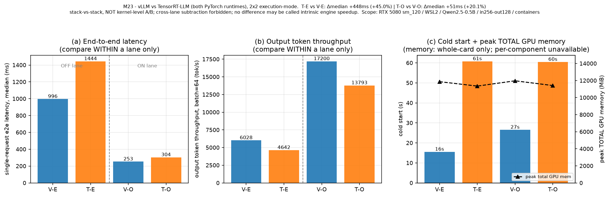

**2×2 execution-mode 设计**：Gate 2 发现 TRT-LLM **默认开启 CUDA Graph** 而本 lab 全线 `enforce_eager`，
而 M7 已证该差异在本机可达单步 7.44→2.50ms —— **它会主导结论**。所以不跑一组，跑两条 lane：

| lane | `T vs V` 单请求 e2e | batch64 | 结论 |
|---|---|---|---|
| **OFF**（graph/optimization 关） | **+45.0%** CI[433.8, 463.0]ms | **+29.9%** | TRT-LLM 更慢 |
| **ON**（各自当前优化栈） | **+20.1%** CI[48.8, 54.0]ms | **+24.7%** | TRT-LLM 更慢 |

冷启动 TRT-LLM **60.5–60.8s** vs vLLM **15.6s(OFF) / 26.6s(ON)**；
输出 token 吞吐 vLLM 6028→17200、TRT-LLM 4642→13793 tok/s。
**两侧从 optimized lane 获益幅度接近**（**2.85×** vs **2.97×**）——这正说明只跑一条 lane 会把
「有没有开图优化」混进「谁的引擎更快」里。

**表述纪律（写进脚本与文档）**：正式跨引擎比较只允许 **T-E vs V-E、T-O vs V-O**；
允许 **V-O vs V-E、T-O vs T-E** 作为同引擎 execution-mode ablation；
**禁止交叉 lane**（T-E vs V-O / T-O vs V-E）做 engine speedup；
**任一差值都不得称为「纯 engine intrinsic speedup」**（OFF lane 仍混着两套 runtime 的实现差异，
ON lane 还叠加了两侧优化栈内容本就不同）；本对照是 **stack-vs-stack，不是 kernel 级 A/B**。

**两个自洽性检查**（不是刻意构造的）：vLLM 的 ON/OFF 吞吐比 **2.85×** 与 **M6** 的 2.5–2.85× 吻合；
V-E 单 token ≈ **7.8ms** 与 **M7** 证实的 ~7ms CPU 提交地板同量级 —— 容器内行为与历史主线一致。

**显存只报整卡**：Gate 2 实测 TRT 侧主进程 `torch.cuda.memory_allocated()` 读到 **0**（executor 在独立 runtime），
分项一律标 `unavailable`，**禁止 `activation = total − weights − KV` 这类残差推导**。
而且两侧显存预算参数**语义不同**（vLLM 的 `gpu_memory_utilization` 是总显存占比，
TRT 的 `free_gpu_memory_fraction` 是可用显存中给 KV 的占比），所以那 −520 MiB 只能读作
「各自这样设置下的峰值差」。

**必须随 V-O/T-O 结论保留的 limitation**：V-E 与 V-O 各自 across-process **6/6 确定性**，
但同引擎 V-O vs V-E exact-match 仅 **1/6** → 两条 execution path **不数值等价**；
人工检视分歧文本均连贯无退化，故只能说「**未观察到明显 functional degradation**」。

**跨引擎 generation consistency**（6 条固定 token-id，不扩成质量 benchmark）：
`T-E vs V-E` exact **2/6**、`T-O vs V-O` **1/6**；mismatch 只记 **numerical divergence**，
**不得直接判为 correctness failure**。TRT fibonacci 因 EOS 停在 45 token，且是 vLLM 的真前缀。

**留痕**：[`results.md`](notes/m23/results.md) · [`cross_engine_plan.md`](notes/m23/cross_engine_plan.md)（设计冻结 v5） ·
[`gate_results.md`](notes/m23/gate_results.md) · `outputs/m23/*` · `scripts/m23_*.py`。**零产品源码改动。**
L2/L3 **明确不做**；暂不追加 kernel profiling。
