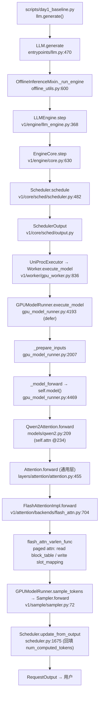
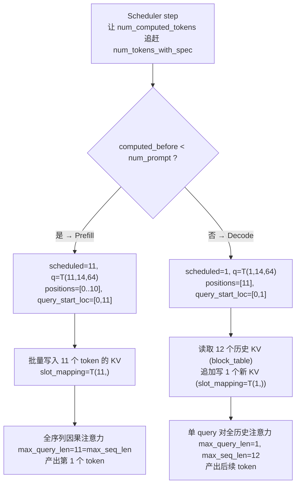

# Day 1 · vLLM V1 单请求推理主链路与 Prefill/Decode 运行时 Trace

> 全部结论以 `logs/day1/single_request_trace.log`（`VLLM_LAB_TRACE=1`）与 `logs/day1/baseline_debug.log` 的**真实运行日志**为依据，对照 `vllm-src` @ `ee0da84`(v0.24.0) 源码。行号为当前带注释/插桩工作树的近似值。

## 1. 实验目标

用一个固定单请求（Qwen2.5-0.5B-Instruct，11 个 prompt token，greedy），验证并观察：
- 请求从 `LLM.generate` 到 Attention backend 再回到输出 token 的**真实调用链**；
- 实际启用的 Engine / Scheduler / Worker / ModelRunner / Attention backend；
- **Prefill 与 Decode** 在调度数据与 Tensor shape 上的差异，以及 KV Cache 如何参与。

方法：在 4 个源文件插入受 `VLLM_LAB_TRACE` 控制的结构化 Trace（默认关闭），单进程运行（`VLLM_ENABLE_V1_MULTIPROCESSING=0`），`--max-tokens 2` 恰好产生 1 次 Prefill + 1 次 Decode。

## 2. 完整运行配置

| 项 | 值 |
|---|---|
| model | `Qwen/Qwen2.5-0.5B-Instruct`（bf16，非量化） |
| prompt | 「请用一句话解释大模型推理中的 KV Cache。」→ **11 tokens** |
| max_tokens | 2（实验）/ 16（基线） |
| vLLM commit | `ee0da84` (v0.24.0)，editable |
| Engine | V1 LLM engine（in-process，async scheduling，batch queue size 2） |
| Scheduler | `vllm/v1/core/sched/scheduler.py::Scheduler`（chunked prefill，max_num_batched_tokens=8192，prefix caching 默认开） |
| Worker | `vllm/v1/worker/gpu_worker.py::Worker`（UniProcExecutor） |
| Model Runner | `vllm/v1/worker/gpu_model_runner.py::GPUModelRunner` |
| Attention backend | **`FLASH_ATTN`（FlashAttentionImpl，FA v2）** |
| eager/graph/compile | enforce_eager=True → torch.compile 关、CUDAGraph 关（cudagraph_mode=NONE） |
| KV cache | dtype bf16，**block_size=16，num_gpu_blocks=34801**，556,816 tokens |
| 环境规避 | `VLLM_USE_FLASHINFER_SAMPLER=0`（WSL 无 nvcc，规避 FlashInfer 采样器 JIT） |

输出：`[84648, 19479]`（' KV Cache'），与 16-token 基线的前两 token 一致 → **Trace 开启未改变推理结果**。

## 3. 真实调用链（含 Trace 证据）

```
用户脚本 scripts/day1_baseline.py: llm.generate([prompt], SamplingParams)
  → LLM.generate                         entrypoints/llm.py:470
  → OfflineInferenceMixin._run_engine    entrypoints/offline_utils.py:600   （while has_unfinished_requests: llm_engine.step()）
  → LLMEngine.step                       v1/engine/llm_engine.py:368
  → EngineCore.step                      v1/engine/core.py:630              （schedule → execute → update）
      ├─ Scheduler.schedule              v1/core/sched/scheduler.py:482     【trace: scheduler/schedule】
      │     → SchedulerOutput            v1/core/sched/output.py
      ├─ Executor.execute_model          v1/executor/uniproc_executor.py    → Worker.execute_model  v1/worker/gpu_worker.py:836
      │   → GPUModelRunner.execute_model v1/worker/gpu_model_runner.py:4193 （延迟执行，返回 None）
      │       ├─ _update_states                                            （SchedulerOutput → InputBatch）
      │       ├─ _prepare_inputs         gpu_model_runner.py:2007          【trace: model_runner/prepare_inputs】
      │       │     构造 input_ids/positions/query_start_loc/seq_lens/slot_mapping/block_table + attn metadata
      │       ├─ set_forward_context + _model_forward  gpu_model_runner.py:4469  【trace: model_runner/model_forward】
      │       │     → self.model(...) = Qwen2ForCausalLM.forward           model_executor/models/qwen2.py
      │       │        → Qwen2DecoderLayer.forward → Qwen2Attention.forward qwen2.py:209  （self.attn(q,k,v) @ :234）
      │       │           → Attention.forward       model_executor/layers/attention/attention.py:455  【trace: attention_layer/forward_in, layer 0】
      │       │              → FlashAttentionImpl.forward  v1/attention/backends/flash_attn.py:704     【trace: flash_attn_impl/forward, layer 0】
      │       │                 → flash_attn_varlen_func （paged attention，读 block_table / 写 slot_mapping）
      │       └─ compute_logits → 缓存 ExecuteModelState
      ├─ (sample) Worker.sample_tokens → GPUModelRunner.sample_tokens gpu_model_runner.py:4572
      │       → Sampler.forward           v1/sample/sampler.py:72          （greedy argmax；本轮原生采样器）
      └─ Scheduler.update_from_output    v1/core/sched/scheduler.py:1675   【trace: scheduler/update_from_output】
            → 回填 num_computed_tokens、追加 output token、判定 finish
  → 输出 RequestOutput → 用户
```

## 4. Prefill 流程（step 1，真实日志）

```
scheduler/schedule   total_scheduled=11 n_new=1 n_cached=0 running=1 waiting=0
                     per_req={'0-…': {scheduled:11, computed_before:0, num_prompt:11, phase:'prefill'}}
model_runner/prepare_inputs num_reqs=1 total_scheduled=11 num_scheduled_tokens=[11]
                     query_start_loc=[0, 11] seq_lens=[11] positions=[0..10] input_ids_len=11
model_runner/model_forward  input_ids=T(11,)int32 positions=T(11,)int64 cudagraph_mode=NONE
attention_layer/forward_in  layer0 num_heads=14 num_kv_heads=2 head_size=64
                     query=T(11,896) key=T(11,128) value=T(11,128)
flash_attn_impl/forward layer0 query=T(11,14,64) key=T(11,2,64) value=T(11,2,64)
                     kv_cache=T(34801,2,16,2,64) num_actual_tokens=11 max_query_len=11 max_seq_len=11
                     query_start_loc=T(2,) seq_lens=T(1,) block_table=T(1,128) slot_mapping=T(11,) fa_version=2 phase=prefill
```

解读：
- 请求首次进入（`n_new=1`），一次性调度全部 **11 个 prompt token**（`computed_before=0 < num_prompt=11` → prefill）。
- `_prepare_inputs`：`query_start_loc=[0,11]`（单请求，本轮 query 覆盖 [0,11)），`positions=[0..10]`，`seq_lens=[11]`。
- 通用 `Attention` 层收到 `q=(11,896)`（896=14×64），`k=v=(11,128)`（128=2×64）；进入 backend 后 reshape 成 **q=(11,14,64)、k=v=(11,2,64)**——GQA：14 个 query head 共享 2 个 KV head。
- **KV Cache 写入**：`slot_mapping=T(11,)` 给 11 个 token 各分配一个 KV slot；`kv_cache=(34801, 2, 16, 2, 64)` = [blocks, K/V, block_size=16, kv_heads=2, head_dim=64]。11 个 token 占用 ⌈11/16⌉=1 个 block（`block_table=T(1,128)`）。
- Prefill 的 Attention 是「11 个 query 对 11 个 key」的全序列因果注意力（`max_query_len=max_seq_len=11`）。此步产出第 1 个 output token。

## 5. Decode 流程（step 2，真实日志）

```
scheduler/schedule   total_scheduled=1 n_new=0 n_cached=1 running=1
                     per_req={'0-…': {scheduled:1, computed_before:11, num_prompt:11, phase:'decode'}}
model_runner/prepare_inputs num_reqs=1 total_scheduled=1 num_scheduled_tokens=[1]
                     query_start_loc=[0, 1] seq_lens=[12] positions=[11] input_ids_len=1
model_runner/model_forward  input_ids=T(1,)int32 positions=T(1,)int64 cudagraph_mode=NONE
attention_layer/forward_in  layer0 query=T(1,896) key=T(1,128) value=T(1,128)
flash_attn_impl/forward layer0 query=T(1,14,64) key=T(1,2,64) value=T(1,2,64)
                     kv_cache=T(34801,2,16,2,64) num_actual_tokens=1 max_query_len=1 max_seq_len=12
                     slot_mapping=T(1,) block_table=T(1,128) phase=decode
scheduler/update_from_output n_sampled_tokens=1 running=1 computed_after={'0-…':12}
```

解读：
- 请求已在 running（`n_cached=1`），`computed_before=11 == num_prompt` → decode。
- 本轮**只输入 1 个新 token**（prefill 产出的第 1 个 output token），`positions=[11]`，`query_start_loc=[0,1]`，`input_ids=T(1,)`。
- backend：`q=(1,14,64)`，但 **`max_seq_len=12`**——即 1 个 query token 要对**全部 12 个历史 KV**（11 prompt + 1 已生成）做注意力。历史 KV 从 `kv_cache` 经 `block_table` 读取（paged attention），新 token 的 KV 经 `slot_mapping=T(1,)` 追加写入。
- `update_from_output`：`num_computed_tokens` 11→**12**，采样出第 2 个 token。

## 6. Prefill / Decode 对照表（全部来自真实日志）

| 维度 | Prefill (step 1) | Decode (step 2) |
|---|---|---|
| 输入 token 数 | 11 | 1 |
| scheduled tokens | 11 | 1 |
| computed_before | 0 | 11 |
| phase 判据 | computed(0) < prompt(11) | computed(11) == prompt(11) |
| input_ids shape | T(11,) | T(1,) |
| positions | [0..10] | [11] |
| query shape (backend) | T(11, 14, 64) | T(1, 14, 64) |
| key/value shape (backend) | T(11, 2, 64) | T(1, 2, 64) |
| query_start_loc | [0, 11] | [0, 1] |
| seq_lens (metadata) | 11 | 12 |
| max_query_len | 11 | 1 |
| max_seq_len | 11 | 12 |
| slot_mapping | T(11,) | T(1,) |
| block_table | T(1, 128) | T(1, 128) |
| KV Cache 行为 | 批量写入 11 个 token 的 KV | 读 12 个历史 KV + 追加写 1 个新 KV |
| Scheduler 行为 | 新请求，n_new=1 | 已运行请求，n_cached=1 |
| cudagraph_mode | NONE | NONE |

**一句话**：Prefill 是「多 query token 一次性建 KV + 全序列注意力」，Decode 是「单 query token 读全量历史 KV + 追加 1 个 KV」。二者共享同一 `kv_cache` 张量与 backend，仅 query 长度、positions、slot_mapping 与 seq_len 不同。

## 7. 与此前静态阅读的对应关系与修正

- **验证正确**：`SchedulerOutput.num_scheduled_tokens` / `query_start_loc` / `slot_mapping` / `block_table` 的角色与静态理解一致；GQA（14 q head / 2 kv head）在 backend 入口 reshape 处得到实证。
- **需要修正/补充**：
  1. Scheduler **不区分 prefill/decode 阶段**（源码注释 `scheduler.py:493-502` 明确说明）：它只让每个 request 的 `num_computed_tokens` 追赶 `num_tokens_with_spec`。prefill/decode 是「computed 是否 < prompt」的**派生**结论，非调度器的显式状态。
  2. V1 是**延迟执行 + async scheduling**：`GPUModelRunner.execute_model` 返回 None、采样在 `sample_tokens` 完成，`EngineCore` 用 size=2 的 batch queue。此前按「execute_model 直接返回 sampled token」的理解需修正。
  3. `execute_model` 只是**编排层**；真正准备张量在 `_prepare_inputs`，真正跑模型在 `_model_forward`，真正写/读 KV 在 `FlashAttentionImpl.forward` 的 `flash_attn_varlen_func`。「封装层 vs 执行层」的边界被 Trace 清晰划开。
  4. `block_size` 实测为 **16**（非猜测），`num_gpu_blocks=34801`——由 `kv_cache=T(34801,2,16,2,64)` 直接读出。
  5. 采样默认走 FlashInfer（`VLLM_USE_FLASHINFER_SAMPLER` 默认 True），在无 nvcc 的 WSL 会 JIT 失败；本轮改用原生采样器。

## 8. 尚未解决的问题（留待 Day 2+）

1. async scheduling（batch queue size 2）在**多请求**下如何交错 prefill/decode（Day 2 continuous batching）。
2. `block_table` 的逻辑块→物理块映射、ref_cnt、prefix cache 命中（Day 3 KV/block 生命周期）。
3. chunked prefill：当 prompt > max_num_batched_tokens 时 prefill 如何被切成多步（本轮 prompt 仅 11 token，未触发）。
4. 推理期 Triton JIT（`_compute_slot_mapping_kernel` 等）的完整清单与 warmup 覆盖（Day 6 性能）。
5. FlashAttention 在 sm_120 选择 FA2 而非 FA3/FA4 的具体判定（`fa_utils.py::get_flash_attn_version`）。

## 9. Mermaid：真实主链路调用图



## 10. Mermaid：Prefill / Decode 分叉


