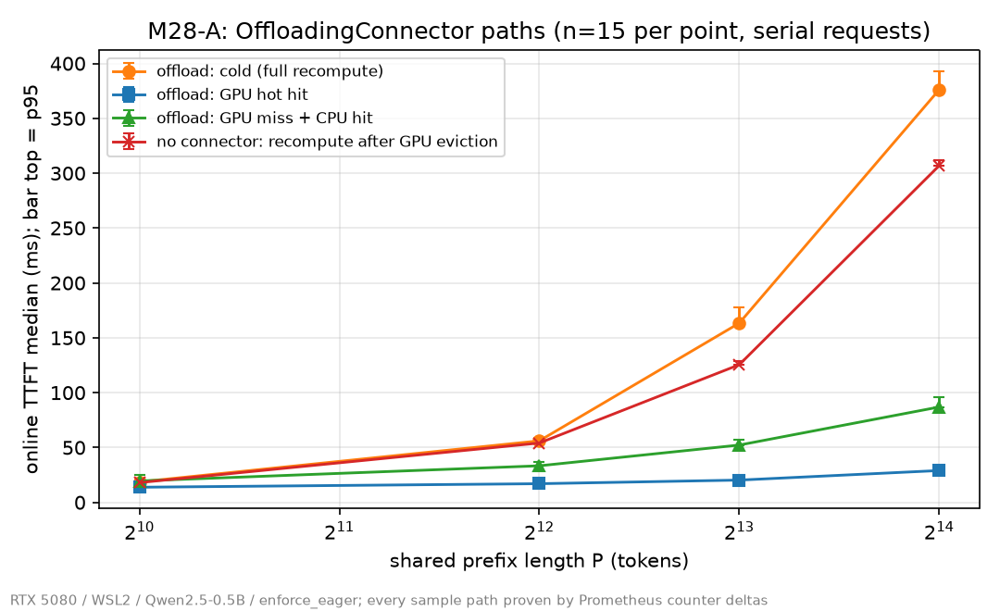
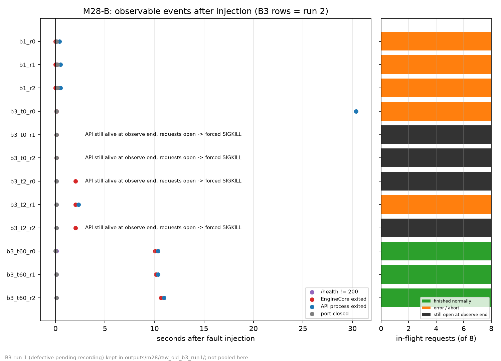

# M28 结果 · KV Offloading（原生 OffloadingConnector）与 Serving 可靠性

> **状态：COMPLETE**（2026-10-12）。A 组 offload / base / ref / evict 4 个 arm、B1 ×3、B3 3 档 ×3 全部执行；B2 由所有者选择不做 → **SKIPPED**。
> `python scripts/check_invariants.py --module m28` → **33 PASS / 0 FAIL / 0 PENDING**；全模块 223 PASS / 0 FAIL / 0 PENDING
> （`logs/m28/check_invariants_{m28,all}.log`）。validator 自检 15/15 反例检出（`logs/m28/validator_selftest_cpu.json`）。
>
> **适用边界（所有绝对值仅限此配置）**：单卡 RTX 5080 / sm_120 / WSL2 / Qwen2.5-0.5B-Instruct / `enforce_eager` /
> vLLM `ee0da84`（v0.24.0 editable）/ 串行在线 HTTP 流式客户端（一次一个请求）/ CPU 层为 **pageable** 内存（`pin_memory=False`）。
> 不外推到 pinned 内存、原生 Linux、更大模型、CUDA graph、并发负载或服务器 GPU。
>
> 计划与冻结配置：[`M28_PLAN.md`](M28_PLAN.md)（v2）；源码核查：[`source_review.md`](source_review.md)；执行过程（含两次修订与 B3 重跑）：
> [`execution_record.md`](execution_record.md)；限制：[`limitations.md`](limitations.md)。

---

## 1. A 组 · OffloadingConnector 的三条路径

### 1.1 路径证明（每个样本两个独立来源）

每个 (arm, P, path) 5 warmup + 15 measure，汇总只用 measure 且 success=True（35 格 × 15 = 525 个 measure 样本全部 success=True）。
路径由 Prometheus 计数器增量判定，validator 独立重算一次（`a_path_recheck` PASS），并与请求级 `usage.prompt_tokens_details.cached_tokens`
逐条相等（`a_cached_eq_metrics` PASS）。

| 路径 | 判据 | 每个 P 的证实数 |
|---|---|---|
| cold（全量重算） | cached=0，Δlocal_hits=0，Δext_hits=0 | 15/15 |
| gpu_hot（GPU prefix cache 命中） | Δlocal_hits = 期望命中 token | 15/15 |
| cpu_hit（GPU 已被 filler 挤掉、CPU 层命中） | Δlocal_hits=0，Δext_hits = 期望命中 token | 15/15（`a_gate_external_hit`） |
| recompute_evicted（base，无 connector） | GPU 被挤掉后 cached=0 | 15/15 |

CPU 命中的搬运量严格守恒：`Δload_bytes / Δext_hits = 12288 B/token`（= 24 层 × 2 × 2 KV head × 64 dim × 2 B），4 个 P 全部一致
（`outputs/m28/m28_a_paths.csv`）。connector 自报的 load 带宽中位数 3.81–3.96 GB/s（例：P=16384 搬 201.5 MB、52.7 ms）。
这是 **pageable** 内存下的值。

### 1.2 延迟（online TTFT，ms，median；n=15/格）

来源：`outputs/m28/m28_a_latency.csv`；图 [`figures/fig19_m28_offload_ttft.png`](../../figures/fig19_m28_offload_ttft.png)。

| P | offload.cold | offload.gpu_hot | offload.cpu_hit | base.cold | base.recompute_evicted |
|---|---|---|---|---|---|
| 1024 | 18.70 | 13.82 | 19.54 | 18.11 | 18.04 |
| 4096 | 56.11 | 17.04 | 33.36 | 54.54 | 54.11 |
| 8192 | 163.37 | 20.33 | 52.25 | 124.24 | 125.47 |
| 16384 | 376.09 | 29.03 | 86.93 | 307.03 | 306.86 |



### 1.3 对照（median difference，Bootstrap 95% CI，固定 seed）

来源：`outputs/m28/m28_a_contrasts.csv`。paired 指同一 (P, idx) 同一 prompt 的配对差；unpaired 指跨 arm（不同 server 进程）的独立样本差。

| 对照 | P=1024 | P=4096 | P=8192 | P=16384 |
|---|---|---|---|---|
| cpu_hit − cold（paired） | **+0.70** [0.53, 2.09] | −22.6 [−23.7, −21.2] | −113.0 [−115.3, −110.4] | −289.6 [−292.9, −279.1] |
| cpu_hit − base.recompute（unpaired） | **+1.51** [0.71, 3.04] | −20.7 [−21.8, −18.8] | −73.2 [−78.6, −70.6] | −219.9 [−221.5, −211.9] |
| cpu_hit − gpu_hot（paired） | +6.0 [4.6, 6.8] | +16.1 [14.8, 17.3] | +32.8 [29.7, 33.7] | +58.0 [56.8, 61.8] |
| offload.cold − base.cold（unpaired） | +0.58 [−0.18, 1.63] | +1.57 [0.86, 2.37] | **+39.1** [34.4, 44.8] | **+69.1** [66.1, 76.2] |
| offload.gpu_hot − base.gpu_hot（unpaired） | −0.89 [−1.48, 0.64] | +0.66 [−1.07, 2.08] | +1.40 [0.44, 2.83] | +1.56 [0.41, 2.33] |
| base.recompute − base.cold（paired） | −0.16 [−1.19, 0.28] | −0.06 [−0.31, 0.35] | +1.27 [0.24, 3.66] | +0.14 [−3.54, 0.86] |

结论（均在上述边界内）：

1. **CPU 命中从 P=4096 起显著快于重算；P=1024 时反而略慢**。P=1024 时 cpu_hit 比 cold 慢 0.70 ms（CI 排除 0），比无 connector 的重算慢 1.51 ms。
   也就是说，在这台机器、这个模型上，CPU→GPU 搬运 12.8 MB 的成本已经不低于 0.5B 模型重算 1K token。P=16384 时 cpu_hit 比无 connector 重算快 220 ms（约 3.5×）。
2. **CPU 命中始终比 GPU 命中慢**，差距随 P 近似线性增长（+6 → +58 ms）。与 load 时间对得上：P=16384 load 52.7 ms，差 58 ms。
3. **开启 connector 后冷请求变慢，且只在长前缀上明显**：P=8192 慢 39 ms、P=16384 慢 69 ms（CI 排除 0）；P≤4096 时 TTFT 差 ≤1.6 ms。
   e2e 上 P=4096 已可见（offload.cold e2e 238 ms vs base.cold 212 ms，`m28_a_latency.csv` 的 e2e 列）。
   connector 自报的 store（GPU→CPU）量与耗时（`m28_a_paths.csv` 的 store 列，cold 路径 median）：P=4096 50.5 MB / 16.0 ms，
   P=8192 100.9 MB / 32.4 ms，P=16384 201.5 MB / 65.1 ms，约 3.1 GB/s。P≥8192 时 store 耗时与冷请求变慢量（39 / 69 ms）量级接近。
   **假设（未验证）**：`--max-num-batched-tokens 8192` 下，P≤4096 的 prompt 一个 chunk 就 prefill 完，store 拖慢的是之后的 decode（所以只在 e2e 上可见）；
   P≥8192 的 prompt（8208+ token）至少两个 chunk，store 卡在 chunk 之间、计入 TTFT。**没有跑 profiler**，不能把这 39/69 ms 归因到具体同步点。
4. **connector 对 GPU 命中路径几乎没有成本**：offload.gpu_hot − base.gpu_hot ≤ 1.6 ms，P≤4096 CI 含 0（只能说"未观察到超出噪声的差"）。
5. **base 的"被挤掉后重算"与冷请求等价**（CI 含 0 或约 1 ms），说明 filler 挤占确实把 GPU 前缀清空了，没有残留命中。

### 1.4 正确性（独立重算对照）

来源：`outputs/m28/m28_a_correctness.csv`；所有对照都是逐 token 比较，必要时也比较 logprob。

| 检查 | 结果 |
|---|---|
| offload.cpu_hit == offload.gpu_hot（token 与 logprob 逐位） | **60/60**，logprob 最大差 0.0 |
| ref_a == ref_b（无 cache 重算两次，确定性） | 60/60 |
| offload.cold == ref、base.cold == ref | 60/60、60/60 |
| cpu_hit / gpu_hot / base.gpu_hot 对 ref | 各 46/60；**分歧的 14 个样本完全相同**（同 idx、同分歧位置） |

→ KV 经 GPU→CPU→GPU 往返**不改变任何输出**（与 GPU 命中逐位相同）。命中路径与全量重算之间有 14/60 的数值分歧，
但这是"带 cache 计算 vs 全量重算"的计算形状差异，**无 connector 的 GPU 命中也有同样的 14 个**，offload 没有新增分歧（`a_corr_offload_adds_no_divergence`）。

### 1.5 淘汰（evict arm，P=4096，CPU 层 256 MiB）

CPU 层只够放约 1365 个 block（256 MiB / 196608 B），filler 写满后目标前缀被 LRU 淘汰：cpu_evicted 15/15 的 `Δext_hits = 0`，
回到重算；TTFT median 55.58 ms，cold 54.79 ms（同 arm，`m28_a_latency.csv`；未做该对的 CI，只报 median）。即**淘汰后静默回退到重算，无报错、无错误命中**。

### 1.6 资源（实测，`outputs/m28/raw/m28_lifecycle.jsonl`）

- 每个 server 就绪后整卡显存 +1924～+1982 MiB（基线 4646–4739 MiB）。
- EngineCore RSS：offload arm 6050.8 MiB，base 1953.7 MiB，**差 4097 MiB = 4 GiB CPU 层**（`torch.zeros` 全量占用，不是按需）；evict arm 2210.8 MiB（+257 MiB）。
- 每个 arm 都核对了日志：connector arm 有 "Creating v1 connector with name: OffloadingConnector" / "Creating offloading spec with name: CPUOffloadingSpec" /
  "Allocating 1 CPU tensors..."，非 connector arm 没有；全部 arm 0 次采样默认值覆盖、0 traceback、0 EngineDeadError（`a_connector_log_evidence`）。

---

## 2. B 组 · 故障与停机

公共负载：4 条流式 + 4 条非流式 `/v1/completions`，在途证据为 4 条流式均已收到首 token 且 `vllm:num_requests_running == 8`（12/12 次成立）。
注入目标身份每次都在发信号前重新核对（`b_target_identity`）。每次演练后：无存活的已知 PID、端口释放、`/dev/shm` 无新增、显存回到基线（`b_cleanup_clean`，正式数据 12/12）。
来源：`outputs/m28/raw/m28_b_drills.jsonl`（B1 ×3 + B3 第二轮 ×9）、`outputs/m28/m28_b_drills.csv`；图 [`figures/fig20_m28_faults.png`](../../figures/fig20_m28_faults.png)。



### 2.1 B1 · SIGKILL EngineCore 子进程（×3，与 M21 杀 API 父进程不同）

| 观测 | r0 / r1 / r2 |
|---|---|
| 在途 4 条流式 | 收到约 257–268 个 token 后，SSE 收到 error 事件（500）+ `[DONE]` |
| 在途 4 条非流式 | HTTP 500 |
| `/health` | 0.10 s 起非 200（r1/r2 先看到一次 503，随后端口关闭） |
| 端口关闭 | 0.10 / 0.20 / 0.20 s |
| API 进程 | **自行退出**，0.40 / 0.50 / 0.50 s，**退出码 0** |
| 故障后 1 s、8 s 的新请求 | 均 ConnectionRefused |
| 日志 | 每次 5 行 EngineDeadError |
| 清理 | `cleanup_needed=False`（无需 runner 兜底）；无孤儿进程，显存回到基线 |
| 同配置重启 | 3/3 成功，就绪 15.0 / 16.0 / 16.0 s |

结论：EngineCore 被 SIGKILL 时，API **不会**留下来以 503 继续服务，而是在 0.5 s 内结束全部在途请求（非流式 HTTP 500；流式此前已返回 HTTP 200，失败通过 SSE error event 报告并收到 `[DONE]`），然后自己退出。
与 M21 的对比：M21 杀的是 API 父进程，留下了持有显存的孤儿 EngineCore；这里杀子进程，没有孤儿。
**运维含义（推断，未在 systemd/k8s 上实测）**：进程以退出码 0 结束，按"非零退出才重启"配置的监督器不会拉起它。需要无条件重启或基于健康检查的重启。

### 2.2 B3 · SIGTERM API × `--shutdown-timeout ∈ {0, 2, 60}`

B3 共执行**两轮**，冻结矩阵相同。第一轮 runner 对"挂住的请求"只记了 `{"missing": true}`，导致 summarize/validate 崩溃。
修复记录逻辑后按同一矩阵重跑了第二轮；第一轮原样保存在 `outputs/m28/raw_old_b3_run1/`、`logs/m28/b3_run1/`，**不与第二轮合并**。
validator 只针对第二轮（正式 raw）。下表两轮逐次列出：

| 档位 | 轮次 | r0 | r1 | r2 |
|---|---|---|---|---|
| t=0（abort） | 第一轮 | 挂住 | 挂住 | 挂住 |
| t=0 | 第二轮 | 8/8 `finish_reason=abort`；API 30.37 s 退出（rc 0） | 挂住 | 挂住 |
| t=2（drain，不足） | 第一轮 | 挂住 | 挂住 | 8/8 报错（非流式 HTTP 500、流式 SSE error 500）；API 2.42 s 退出 |
| t=2 | 第二轮 | 挂住 | 8/8 报错（非流式 HTTP 500、流式 SSE error 500）；API 2.31 s 退出 | 挂住 |
| t=60（drain，充足） | 第一轮 | 8/8 `length`；API 12.47 s 退出 | 8/8 `length`；11.87 s | 8/8 `length`；12.72 s |
| t=60 | 第二轮 | 8/8 `length`；10.36 s | 8/8 `length`；10.35 s | 8/8 `length`；10.96 s |

"挂住"的定义：90 s 观测窗结束时 API 进程仍存活、在途请求既没有结束也没有报错。runner 随后按清理流程 SIGTERM → SIGKILL（rc −9）。
第二轮在清理后补记了终态：非流式 `RemoteDisconnected`、流式 EOF 且无 `[DONE]`（`outcomes_after_cleanup` 列）。
**挂住时 EngineCore 已退出**（t=0 档 0.10 s，t=2 档约 2.01 s），显存已归还，只剩 API 进程和打开的连接。

所有档位共同的现象：

- **端口在 SIGTERM 后约 0.1 s 就关闭**，包括 t=60 drain 档（t60_r0 为 0.002 s）。日志在 shutdown trigger 后立刻出现 uvicorn 的 "Shutting down" /
  "Waiting for connections to close"——uvicorn 自身的信号处理先关掉了监听口。所以 **drain 只保护已在途的请求，不接收新连接**，新请求是 connection refused 而不是 503。
- 故障瞬间（监听口关闭前）已建立连接的那个探针：drain 档（t=2、t=60）立即收到 `200 + finish_reason=abort`（耗时 0.01 s；t60_r0 是 ConnectionReset）。
  t=0 档 6/6 都是 30 s 客户端超时，从未收到响应。注意 **drain 期间拒绝新请求的方式是 HTTP 200 + abort**，客户端必须看 `finish_reason` 才能判断失败。
- t=60 的前提核对通过（`b_b3_timeout_precondition`）：同进程校准批次实测剩余工作 8.2–8.6 s（第二轮），< 55 s。EngineCore 在约 10–10.7 s 退出，API 再晚约 0.2–0.3 s，退出码 0。

### 2.3 挂住的机制（日志 + 源码）

对 12 次 t=0 / t=2 演练逐个统计 EngineCore 的 shutdown 日志：

| 档位 | EngineCore 写出 abort/drain 且 "request processing complete" | API 侧 EngineDeadError | 结局 |
|---|---|---|---|
| t=0 | 1/6（第二轮 r0） | 0/6 | 该次 8/8 abort；其余 5 次挂住 |
| t=2 | 0/6（drain 开始了，但 2 s 内没完成，被 force kill） | 2/6 | 有 EngineDeadError 的 2 次 → 在途请求报错（非流式 500、流式 SSE error）并退出；其余 4 次挂住 |

- `shutdown_timeout=0` 时，process manager 对 EngineCore 先 `terminate()`，然后在 deadline 已过的情况下直接 `kill_process_tree`（`vllm/v1/utils.py:603-625`）。
  SIGTERM 与 SIGKILL 几乎同时到达，EngineCore 的 SIGTERM handler 能否先把 abort 发回 API，是一场竞争（源码核查预测 P-B3-1，与实测一致）。
- 在途请求只有收到 abort 输出或 EngineDeadError 才会结束。两者都没收到时，HTTP handler 一直在等。
- API 侧 shutdown 走完 engine client 之后执行 `server_task.cancel()`（`vllm/entrypoints/launcher.py:128-129`），进入 uvicorn `Server.shutdown`，
  它以 `wait_for(_wait_tasks_to_complete(), timeout=config.timeout_graceful_shutdown)` 等待连接关闭（`uvicorn/server.py:269-304`，uvicorn 0.51.0）。
  `timeout_graceful_shutdown` 默认 `None`（`uvicorn/config.py:230`），而 `ee0da84` 的 vLLM 源码里没有任何地方设置它（`rg timeout_graceful_shutdown vllm/` 无结果）。
  **所以只要还有一个连接没关，这一等待在源码层面就没有上限**；实测中挂住的演练在 90 s 观测窗结束时仍未退出，由 runner 外部清理结束（不代表数学意义上永远不会退出，见下条旁证）。
- 旁证：第二轮 t0_r0 的 8 条请求都已 abort 结束，唯一还开着的是故障瞬间的探针连接；它在 30.03 s 时因客户端超时断开，API 在 30.37 s 退出。
  也就是说"挂多久"由客户端什么时候放弃决定。
- **未定位**：t=2 档里为什么有 2/6 次 API 侧收到了 EngineDeadError、其余 4 次没有（推测与 output handler 是先观察到进程死亡还是先被 MPClient 关闭有关），没有做源码级确认。

结论（边界内，n=3/档/轮）：

1. **`--shutdown-timeout` 足够大（60 s、剩余工作约 10 s）时，SIGTERM 能让在途请求全部正常完成**（两轮 6/6），API 以 rc 0 退出。
2. **timeout=0 和不足的 timeout=2 都不可靠**：t=0 两轮 6 次中 5 次挂住，t=2 两轮 6 次中 4 次挂住。挂住的演练在 90 s 观测窗内没有自行退出，由外部 SIGKILL 结束，在途客户端收到的是连接断开而不是错误码。
   哪种结局取决于竞争，3 次重复不足以估计概率，只能说"两种结局都可复现"。
3. 不管哪个档位，**新连接在 SIGTERM 后约 0.1 s 被拒**。

### 2.4 B2

SIGSTOP / SIGCONT 演练：所有者选择不做 → **SKIPPED**（`b_counts`："B2 未执行"）。

---

## 3. 源码核查预测 vs 实测

| 预测（`source_review.md`） | 实测 |
|---|---|
| P-A1 cpu_hit 由 `external_prefix_cache_hits` 体现 | 成立（60/60） |
| P-A2 load 字节 = 命中 token × 每 token KV 字节 | 成立，恒为 12288 B |
| P-A3 往返不改输出 | 成立（60/60 逐位） |
| P-A4（v2 更正）CPU 层为 pageable `torch.zeros` | 成立：日志 "Allocating 1 CPU tensors..."、`/dev/shm` 无 mmap、RSS +4 GiB |
| P-B1 EngineCore 死亡后在途请求得到错误、`/health` 非 200 | 成立；另发现 API 自行退出（rc 0），没有停在 503 状态 |
| P-B3-1 timeout=0 存在竞争 | 成立，且竞争的输家在 90 s 观测窗内未退出、需外部清理（uvicorn 无 graceful 超时）——这一点源码核查阶段没有预测到 |
| P-B3 drain 充足时在途请求完成 | 成立（6/6） |

## 4. 复现

```bash
source .venv/bin/activate
export VLLM_USE_FLASHINFER_SAMPLER=0 VLLM_ENABLE_V1_MULTIPROCESSING=0
python scripts/m28_summarize.py && python scripts/m28_validate.py && python scripts/m28_figures.py   # 离线，不需 GPU
python scripts/check_invariants.py --module m28
# GPU 实验（需授权；命令见 M28_PLAN.md §11）
```
