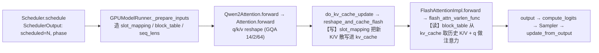

# M4 · Attention Backend —— 从 SchedulerOutput 到 KV 写入再到 Attention 读取的闭环

> 目标：用一次真实运行的 trace，把"调度决定 → 准备张量 → 写 KV → 读 KV 做注意力"这条链**完整串起来、看得见**。
> 证据：`outputs/m4/m4_closed_loop.jsonl`、`logs/m4/m4_closed_loop.log`（单请求，11 token prompt，`--max-tokens 2`，捕获 layer 0）。id 后缀已省略。

## 0. 一句话结论
在本机（RTX 5080）上，vLLM 自动选中 **FlashAttention backend（`FlashAttentionImpl`，FA v2）**。它把一次 attention 拆成**两个独立的 CUDA 算子**：
1. **写**：`reshape_and_cache_flash(...)` —— 用 **`slot_mapping`** 把这一步新算出的 K/V 散写进 KV cache。
2. **读**：`flash_attn_varlen_func(...)` —— 用 **`block_table`** 从 KV cache 里把该请求的历史 K/V 取出来，和当前 query 做注意力。
Python 只负责准备张量和 metadata；真正的读写发生在这两个算子里，这就是 **Python 层与 kernel 的边界**。

## 1. 选中的 backend（怎么来的）
- 日志（M1 已记）：`platforms/cuda.py` "Using FLASH_ATTN attention backend out of potential backends: ['FLASH_ATTN','FLASHINFER','TRITON_ATTN','FLEX_ATTENTION']" + "Using FlashAttention version 2"。
- 即：sm_120 非 MLA 的候选按优先级 `FLASH_ATTN → FLASHINFER → TRITON_ATTN → FLEX_ATTENTION`，取第一个有效的 → FLASH_ATTN；未主动设 `VLLM_ATTENTION_BACKEND`。
- （按 M4 范围，backend 的穷举对比、FlashInfer/sm_120 深挖等**不做**，只跟当前真实主线。）

## 2. Q/K/V 的形状与 reshape（GQA 一眼看清）
两个层次的 shape（trace 实测）：

| 阶段 | query | key | value | 说明 |
|---|---|---|---|---|
| 通用 `Attention` 层入口（`attention_layer/forward_in`） | `T(N, 896)` | `T(N, 128)` | `T(N, 128)` | 还是"扁平"的 hidden 维（N=本步 token 数） |
| 进入 backend 后（`flash_attn_impl/forward`） | `T(N, 14, 64)` | `T(N, 2, 64)` | `T(N, 2, 64)` | reshape 成 (tokens, heads, head_dim) |

- **GQA**：query 有 **14 个头**、key/value 只有 **2 个头**，head_dim=64。所以 896=14×64（Q），128=2×64（K/V）。14 个 query 头共享 2 个 KV 头。

## 3. KV cache 张量长什么样
- `kv_cache` 形状 **`T(34801, 2, 16, 2, 64)`** = `[num_blocks=34801, K&V=2, block_size=16, kv_heads=2, head_dim=64]`。
- backend 里先 `key_cache, value_cache = kv_cache.unbind(1)` 把 K/V 这一维拆开：
  - `key_cache = value_cache = T(34801, 16, 2, 64)` = `[num_blocks, block_size=16, kv_heads=2, head_dim=64]`。
- 也就是说：整块 KV cache 是"按物理块组织的一大张连续显存"，每块能放 16 个 token 的 K 和 V。

## 4. 闭环：一步 attention 的四个环节（真实 trace，Prefill 步）
```
① scheduler/schedule      total_scheduled=11  phase=prefill        # 调度决定：本步给请求 0 安排 11 个 token
② model_runner/prepare_inputs  query_start_loc=[0,11] seq_lens=[11] positions=[0..10]   # 准备张量与 metadata
③ attention_layer/forward_in   query=T(11,896) key=T(11,128) value=T(11,128)            # 进入注意力层的 q/k/v
④ attention/kv_write       slot_mapping=T(11,)  key=T(11,2,64) value=T(11,2,64) → kv_cache=T(34801,2,16,2,64)   # 写：slot_mapping 把新 K/V 散写进 cache
⑤ attention/attn_read      block_table=T(1,128) k_cache=T(34801,16,2,64) q=T(11,14,64) max_seqlen_k=11          # 读：block_table 指路，从 cache 取 K/V 与 q 做注意力
⑥ scheduler/update_from_output  computed_after=12（下一步）                                # 回填，进入 decode
```
**这就是退出标准要求的闭环**：`SchedulerOutput(①)` → `准备 slot_mapping/block_table(②)` → `KV 写入用 slot_mapping(④)` → `Attention 读取用 block_table(⑤)`。

## 5. slot_mapping 与 block_table 到底各干什么（关键区别）
- **`slot_mapping`（写）**：长度 = 本步 token 数（prefill=11、decode=1）。它给**每个新 token**指定"写到 KV cache 的哪个槽位"（物理块×16 + 块内偏移）。算子 `reshape_and_cache_flash` 按它把新 K/V 逐 token 散写进 `key_cache/value_cache`。→ 见 `attention/kv_write`：prefill `slot_mapping=T(11,)`，decode `slot_mapping=T(1,)`。
- **`block_table`（读）**：形状 `[num_reqs, max_blocks]`（这里 `T(1,128)`）。它记录**每个请求的逻辑块→物理块**映射。算子 `flash_attn_varlen_func` 按它把该请求**全部历史 K/V**从 cache 里"拼"出来给注意力用。→ 见 `attention/attn_read`：两步的 `block_table` 都是 `T(1,128)`，但读取长度不同（见下）。

一句话：**slot_mapping 决定"新 K/V 写到哪"，block_table 决定"读时到哪找历史 K/V"。**

## 6. Prefill 与 Decode 在 metadata 上的差别（同一条链，参数不同）
| 维度 | Prefill（step1） | Decode（step2） |
|---|---|---|
| 本步 token 数 | 11 | 1 |
| query（backend） | T(11,14,64) | T(1,14,64) |
| slot_mapping（写几个 KV） | T(11,) | T(1,) |
| max_seqlen_q（query 长度） | 11 | 1 |
| max_seqlen_k（读多长历史） | 11 | **12** |
| seqused_k / block_table | T(1,) / T(1,128) | T(1,) / T(1,128) |

- **Prefill**：一次写 11 个 KV，注意力是"11 个 query 对 11 个 key"（`max_seqlen_q=max_seqlen_k=11`）。
- **Decode**：只写 1 个新 KV，但要读**全部 12 个历史 KV**（`max_seqlen_q=1, max_seqlen_k=12`）——这正是 decode "1 个 query 对全历史" 的特征。
- 二者走的是**同一套算子**，区别只在 metadata（query 长度、slot_mapping 长度、max_seqlen_k）。

## 7. Python 层 ↔ kernel 边界
- **Python 侧**：`GPUModelRunner._prepare_inputs` 造好 `slot_mapping / block_table / query_start_loc / seq_lens`；通用 `Attention.forward` 做 q/k/v 的 reshape 与 dtype 处理。
- **kernel 边界**：真正落到 CUDA 的是两个算子——
  - 写：`vllm/v1/attention/backends/flash_attn.py::FlashAttentionImpl.do_kv_cache_update → reshape_and_cache_flash`；
  - 读：`... FlashAttentionImpl.forward → flash_attn_varlen_func`。
- 我们的 trace 钩子正好卡在这两个算子**调用前**，所以看到的是"进 kernel 前 Python 准备好的张量与 metadata"，kernel 内部（tile、softmax、paged 读取）不在 Python 可见范围——这就是边界。

## 8. Mermaid：闭环图（真实类名/算子）


## 9. 与其它模块的衔接
- M1 已给出主链路与 P/D 的 shape；M3 讲清了 block/slot_mapping 在 KV 管理层的分配与命中。**M4 补上的是"backend 侧"最后一环**：这些 metadata 具体被哪两个算子、以什么形状消费，写与读如何分工。
- 尚未做（属后续模块）：这两个算子的**耗时/瓶颈**（→ M6 Benchmark / M7 Profiler），以及 slot_mapping 类 kernel 的自己实现（→ M8）。

## 附：复现
```bash
cd /home/ciaran/projects/vllm-inference-lab && source .venv/bin/activate
VLLM_LAB_TRACE=1 VLLM_LAB_TRACE_MAX_STEPS=10 VLLM_LAB_TRACE_LAYER=0 \
VLLM_LAB_TRACE_JSONL=outputs/m4/m4_closed_loop.jsonl \
VLLM_USE_FLASHINFER_SAMPLER=0 VLLM_ENABLE_V1_MULTIPROCESSING=0 \
python scripts/m1_baseline.py --max-tokens 2 --out outputs/m4/m4_baseline.json 2>&1 | tee logs/m4/m4_closed_loop.log
```
